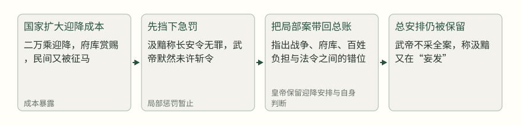
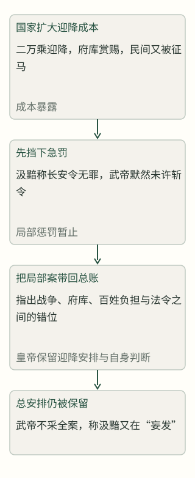
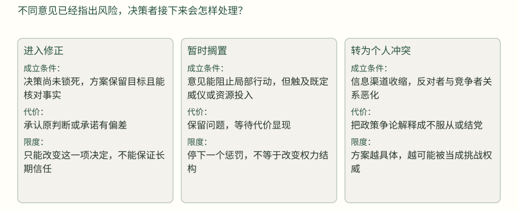
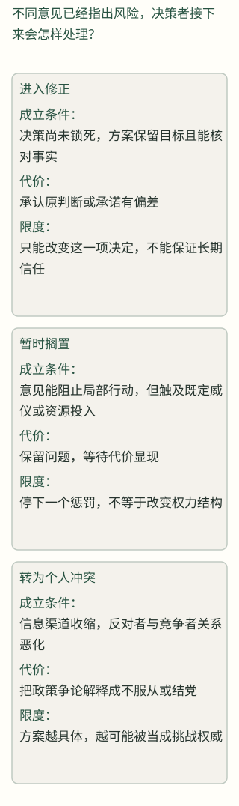

# 逆耳的话：为什么说得有道理，别人还是听不进去？

> 从汲黯、魏征到陆贽，看不同意见怎样进入决定，又怎样变成个人冲突

有道理的意见并不会自动改变决定。汲黯常常说中问题，却也屡被武帝斥为“妄发”；魏征在太宗愿意让他进入政策过程时，能把反对变成修正；陆贽有具体方案、有制度理由，却在德宗的猜疑、近臣的竞争和决策渠道的收缩中败下阵来。三案共同说明，进谏的成败不只在措辞，更取决于决策者的利益、对威胁的理解、替代方案的可执行性，以及一个制度是否允许反对意见留下记录、获得复核。

公元前121年，汉武帝为迎接浑邪王降汉，调动二万乘车，府库耗费巨大，又要让长安商民承担死罪。右内史汲黯先替长安令挡下一刀，接着在私下进见时，把这场盛大的受降拆成几个问题：匈奴降众究竟应怎样安置，百姓已经为战争付出什么，法令为何只看见卖货的细节而看不见国家自己的铺张。武帝听完“默然不许”，还说：“吾久不闻汲黯之言，今又复妄发矣。”[^s1] 这不是一个“不会表达”的故事：汲黯指出了成本，也提出了处理方向；问题在于，皇帝眼前要维护的是受降的政治成果和天子威仪，汲黯要求他同时承认这套安排伤害了民众。意见越接近决定的核心，阻力有时越大。

### 图：汲黯劝阻“迎降”安排：意见进入决定的四个关口

图中前两步是《通鉴》明载的行动，后两步是依据原文重建的决策关系；局部的急罚被挡下，不等于迎降总安排被改写；箭头表示先后和传递，不表示汲黯的建议必然能够改变政策。[^s1] [^s2]

## 一、逆耳，不等于说错；被拒，也不等于不会说

把进谏失败归咎于“情商低”很方便，却会遮住最需要解释的部分。汲黯的确有“性倨少礼，面折，不能容人之过”的一面；他在朝廷上直接说武帝“内多欲而外施仁义”，武帝当场变色罢朝。[^s3] 但同一人物曾在河内水旱之后越权发仓赈民，主动归还节符请罪，武帝认为他贤而释放；他治理东海，“责大指而已，不苛小”，一年多后“东海大治，称之”。[^s4] [^s18] 这些记载至少说明，汲黯并非只会冲撞，也并非没有行政判断。把他的失势全部解释为语气问题，反而不能说明为什么皇帝在某些场合重用他，在另一些场合却把他的提醒当成“妄发”。

汲黯的意见往往有两个特点。第一，他把皇帝正在追求的象征性目标，重新翻译成百姓承担的实际成本：迎接降王、制作乐歌、兴兵用法，都不能只看是否符合礼制或皇帝的兴致。武帝得到神马后命人作歌，汲黯问“先帝百姓岂能知其音邪”，武帝“默然不说”。[^s5] 第二，至少在迎降这一案的记载中，他没有另给一套让皇帝逐步收回部署、又能保全面子的渐进安排。他提出把俘获物分给死事者家属、以此回应天下苦战，又批评不合比例的刑罚；这些是具体主张，但落实仍会触动已经作出的迎降部署、赏赐承诺和官吏责任。[^s1] 对一个已经投入巨大资源、需要把受降讲成胜利的君主来说，接受汲黯的全套批评，等于承认自己的大政在民间造成了反效果。

然而，汲黯并非完全没有影响。他反对长安令被杀，武帝“默然”，随后记载的结果是没有写出斩长安令；这至少说明他的意见可能挡住一次即时惩罚，但不能据此说迎降总安排被改变。[^s1] [^s2] 后来他被调往淮阳，仍为不能参与朝廷议事而忧虑，向李息说张汤“专阿主意”，并预言“公与之俱受其戮矣”；李息因畏惧不敢说，张汤败后，武帝反而追究李息。[^s6] 这里出现了一个常被忽视的区别：意见可以在局部阻止一项行动，却未必能改变产生这项行动的权力关系。汲黯能充当一道硬闸，却无法把所有决定变成可共同审议的过程。

## 二、魏征的成功，关键在于反对意见进入了政策过程

唐太宗即位初年，史书记载他“数引魏征卧内，访以得失；征知无不言，上皆欣然嘉纳”。这句记载容易被读成一幅理想君臣图，但紧接着的事件更有解释力：太宗先接受封德彝关于扩大征兵的意见，诏令已经发出，魏征仍坚持不署，双方争到数次，太宗发怒召责。魏征没有停留在“此举残暴”的道德指责，而是指出兵力不在多、号令必须守信，并逐条对照太宗即位时免除负担、免租和“以来年为始”的承诺，说明此刻再征中男会让百姓无法理解朝廷的信用。太宗先问“朕何为失信”，听完后承认“朕过深矣”，停止征发。[^s7]

> 夫兵在御之得其道，不在众多。
> — 魏征所言／《通鉴》正文 [^s7]

这次被听见，不只是因为魏征说得锋利。它至少有四个条件。其一，太宗正在建立新朝，需要把“诚信”变成统治资源，因此魏征把征兵问题连接到皇帝自己的公开承诺，改变了问题的利益结构。其二，建议有可执行的否定理由：不点中男，而不是抽象地要求仁慈。其三，魏征掌握了诏令与前后政策的具体文本，能让“失信”成为可核对的行政矛盾。其四，太宗允许争论留在决策内部，甚至在自己误判后公开改口。意见因而不是一次性的情绪冲撞，而是进入了政策修正。

魏征也并非永远被听从。岭南冯盎等部长期不入朝，地方不断报告“反”，太宗已经命将军调动江岭数十州兵。魏征说反状未成，若真反应当分兵据险、攻掠州县；既然多年只有告发而兵不出境，说明更可能是疑惧和未被安抚。他提出派可信使者示以至诚。太宗因此罢兵，遣李公掩慰谕，冯盎遣子入朝，并称一使胜十万兵。[^s8] 但这次成功不能证明太宗总会接受魏征：它恰好发生在军事行动尚未出境、撤回成本尚可承受，且使者方案能保留皇帝“使其来朝”的目标。若兵已深入、将领已承担战功和损失，停止行动的政治代价便会不同。

同年，魏征被告发偏私亲戚。温彦博查无实据，却说他“不存形迹，远避嫌疑”，太宗便让人责备魏征，要求他“自今宜存形迹”。魏征回答，君臣应当“相与尽诚”，若上下都只顾留下可供自保的痕迹，国家兴亡便不可知；他还区别“良臣”与“忠臣”，希望做能与君主协同成事的良臣，而不是以死争名的忠臣。太宗最终后悔并赏赐。[^s9] 这段对话的价值在于，它显示允许反对并不等于取消边界：皇帝仍担心任用和避嫌，魏征则认为过度防范会摧毁真实信息。开放渠道是相互承担风险的安排，而不是单方面要求臣下勇敢。

### 图：同一条逆耳意见，在哪些条件下可能被听见？

这是作者根据三案重建的判断树，不是三位当事人共同列出的制度清单。条件越接近决策者的当前利益、越能落成可执行步骤，越可能进入修正；但即使满足这些条件，也不能保证采纳。[^s7] [^s8] [^s10] [^s12]

## 三、陆贽：有具体方案，也可能输给信任结构

陆贽的案例最能纠正“只要给方案就会被接受”的想象。贞元八年，边防储备出了问题，他把原因拆为指挥权分散、军队互不统属、中央遥控延误，以及和籴制度执行变形。他不是只说“边防危险”，而是指出“彼之号令由将，而我之节制在朝”，并继续分析粮食在不同地区的价格和运输损耗。[^s10] 在另一份奏议中，他面对窦参被指控交结藩镇，要求按证据审理、区分贪纵与谋反，反对在罪状暧昧时骤加死刑；又在皇帝要籍没家财时，指出应先依罪法定罪，再决定财产处理。[^s11] [^s12] 这些意见都把原则落到了程序和数字上。

> 至于潜怀异图，事迹暧昧。
> — 陆贽所言／《通鉴》正文 [^s12]

陆贽还曾在宣武军变局中提出一套可操作的缓冲办法：先派朝臣宣劳，查清士凝被逐的事实；不要仓促以亲王接管；另选文武臣为节度使，以诏书安抚军队，给万荣以抚定之功，使将士获得赏赐。他承认自己不擅长亲自作战，却说明自己“经武伐谋或有所见”，并预判万荣若得志可能骄横、犯上或使军队失望。[^s13] 德宗最终没有接受这套方案，任命亲王为节度大使，万荣留后。这里的失败不能简单归于陆贽“太锐”：他确实提供了替代路径，但皇帝面对的是一支已经逐士宁、可能继续失控的军队，等待和调查本身也有风险；陆贽的判断可能正确，仍不等于皇帝愿意把主动权交给这套判断。

转折发生在裴延龄问题上。群臣因延龄受宠而不敢说，陆贽独自承担，反复陈述不可任用，最后上书极陈其奸诈。[^s14] 史家随后说明，赵憬原是陆贽引荐入相，后来与陆贽有隙，把陆贽弹劾延龄的内容告诉延龄；延龄因此更有机会反制，德宗“由是信延龄而不直贽”。陆贽与赵憬约定一同在皇帝面前极论延龄，赵憬临场沉默，德宗怒形于色，陆贽被罢相。[^s15] 这里的证据支持一种有限判断：意见失败至少部分来自渠道和联盟破裂，而非内容突然变得不可理解。我们不能据此断定延龄所有罪状都已被证实，也不能把陆贽的奏议自动当成完全正确；但可以确定，皇帝获得的信息已不再通过同一套相互制衡的关系传递。

罢相后，延龄又把旱灾、军粮不足说成陆贽等“失势怨望”以动摇众心，恰逢皇帝在苑中听到神策军士诉说马草不足，便把延龄的指控当成可信，陆贽被贬。[^s16] 这段很尖锐：陆贽此前关于财政和军粮的担忧并非凭空捏造，现场的新消息却被重新嵌入“失势者动摇军心”的叙事。一个真实问题可以被用来证明错误的动机；反过来，一份有事实的奏疏也可能因提出者的政治位置改变而失去可信度。

## 四、真正的“听不进去”，有三种不同形态

三案放在一起，不能得出“皇帝都不爱听忠言”这样空泛的结论。汲黯的意见常能让一项即时惩罚停顿，却难把皇帝从已经投入的象征性工程中拉出来；魏征在太宗把诚信、求治和公开改过当作统治利益时，能够进入政策文本、征发命令和外交选择，因而多次促成修正；陆贽面对的是更高复杂度的组织问题，他给出制度和财政方案，却在皇帝的猜疑、宰相间的竞争和近臣垄断信息后，连“方案是否值得讨论”都变成了对他个人的判断。

所以，判断一条逆耳意见时，至少应分开四个问题。第一，它指出的是事实、利益冲突，还是价值判断？汲黯说百姓承担了战争成本，陆贽说军粮和边防指挥出了结构性问题，都是可以追查的事实主张；“内多欲而外施仁义”则同时包含道德指责，容易让对方先保护自我形象。第二，意见有没有保留决策者想保留的目标？魏征没有只说不要征兵，而是说要以壮健之兵、守住诚信；劝停岭南用兵，也保留了让冯盎入朝的目标。第三，执行替代方案的成本由谁承担、谁拥有复核权？陆贽的缓兵和改任方案会重新分配军队与中央的控制权，这正是皇帝最难放手的部分。第四，表达者是否还在一个能让不同意见被独立复核的渠道里？陆贽失去的不是一场辩论，而是共同进言的联盟和对信息的解释权。

这套区分也能解释为什么“让人敢说”本身不够。唐太宗后来称君主需靠忠臣如明镜，并告诫群臣不要吝惜尽言。[^s9] 但唐代后来的谏官又指出，若不能预先召见、参与政事，等诏令已经发出才许用短疏挽回，就很难真正改变决定。[^s17] 反对意见需要的不只是勇气，还包括进入讨论的时间、接触材料的权限、不会被单一中介截断的传递路径，以及被拒后仍能继续工作的安全边界。没有这些条件，皇帝可以口头赞美直臣，实际却只收到经过筛选、迎合当前意愿的消息。

## 结语：先查意见卡在哪一层，再评价说话的人

“有道理却没人听”不是一个单一问题。它可能卡在事实没有核验，可能卡在建议只否定而没有可行替代，也可能卡在决策者已经把资源、声望和责任押在另一条路上；更危险的是，意见尚未进入公开讨论，就先被改写成某人的私心、怨望或结党。汲黯提醒我们，直指成本能阻止局部伤害，却未必改变目标；魏征提醒我们，具体文本、替代步骤和可承受的退出方式，能把冲突变成修正；陆贽提醒我们，最详尽的方案也无法独自修复一个已经失去共同信任的渠道。[^s1] [^s7] [^s15] [^s16]

读史或处理现实争议时，可以先问四句：这条意见中哪些是可核对事实，哪些是解释？它保留了对方必须守住的目标吗？谁要为替代方案付出成本，谁能在执行中复核？意见是在决定前进入，还是在决定后才被允许抱怨？这些问题不能保证建议被采纳，却能避免把后果倒推成“他本来不会说话”，也避免把说中问题的人自动塑造成永远正确的圣贤。进谏的价值，有时在改变命令，有时在留下另一份记录；而一个真正允许反对的制度，必须让这两种价值都能被看见。

## 来源与原书阅读

[^s1]: 卷19，公元前121年条，本年段落9（正文）：臣愚以为陛下得胡人，皆以为奴婢，以赐从军死事者家，所卤获，因予之，以谢天下之苦，塞百姓之心。。汲黯在浑邪王降汉后提出处置俘获、回应战争成本的建议，并批评杀商民；支持“有具体替代方案仍被拒”的核心事实。 原书：https://deewins.top/reader.html#volume-19-year-121-para-8

[^s2]: 卷19，公元前121年条，本年段落9（正文）：上默然不许，曰：“吾久不闻汲黯之言，今又复妄发矣！”。武帝对汲黯建议的直接反应。 原书：https://deewins.top/reader.html#volume-19-year-121-para-8

[^s3]: 卷17，公元前135年条，本年段落17（正文）：黯为人，性倨少礼，面折，不能容人之过。。记载汲黯直面批评、礼数少的一面及其与武帝冲突的背景。 原书：https://deewins.top/reader.html#volume-17-year-135-para-16

[^s4]: 卷17，公元前135年条，本年段落16（正文）：臣谨以便宜，持节发河南仓粟以振贫民。臣请归节，伏矫制之罪。。汲黯处理水旱、先行赈济并请罪，证明其有行政判断与承担责任的行动。 原书：https://deewins.top/reader.html#volume-17-year-135-para-15

[^s18]: 卷17，公元前135年条，本年段落16（正文）：岁余，东海大治，称之。。《通鉴》记载汲黯治理东海一年余后大治，支持其行政成效的具体结果。 原书：https://deewins.top/reader.html#volume-17-year-135-para-15

[^s5]: 卷19，公元前120年条，本年段落8（正文）：凡王者作乐，上以承祖宗，下以化兆民。今陛下得马，诗以为歌，协于宗庙，先帝百姓岂能知其音邪？。汲黯把宫廷礼乐与百姓可理解性联系起来，说明其常将象征性决策翻译为公共利益问题。 原书：https://deewins.top/reader.html#volume-19-year-120-para-7

[^s6]: 卷20，公元前118年条，本年段落4（正文）：息畏汤，终不敢言；及汤败，上抵息罪。。汲黯指出张汤问题而李息因畏惧未敢上言，后来被追责，显示信息渠道的风险。 原书：https://deewins.top/reader.html#volume-20-year-118-para-3

[^s7]: 卷192，公元626年条，本年段落18（正文）：陛下每云：『吾以诚信御天下，欲使臣民皆无欺诈。』今即位未几，失信者数矣！。魏征以既有诏令和诚信承诺反对扩大征兵，太宗随后承认过失并停止点中男。 原书：https://deewins.top/reader.html#volume-192-year--626-para-17

[^s8]: 卷192，公元627年条，本年段落31（正文）：若遣信臣示以至诚，彼善于免祸，可不烦兵而服。。魏征反对仓促讨伐岭南，提出派使者安抚的替代方案，太宗采纳后冯盎入朝。 原书：https://deewins.top/reader.html#volume-192-year--627-para-30

[^s9]: 卷192，公元627年条，本年段落35（正文）：臣闻君臣同体，宜相与尽诚；若上下俱存形迹，则国之兴丧尚未可知，臣不敢奉诏。。魏征反对以“存形迹”替代坦诚，太宗随后表示悔意，说明开放渠道需要双方承担风险。 原书：https://deewins.top/reader.html#volume-192-year--627-para-34

[^s10]: 卷234，公元792年条，本年段落19（正文）：彼之号令由将，而我之节制在朝，。陆贽分析边防指挥和储备制度的结构性问题，支持“有具体制度解释”的判断。 原书：https://deewins.top/reader.html#volume-234-year--792-para-18

[^s11]: 卷234，公元793年条，本年段落5（正文）：夫听讼辩谗，必求情辨迹，情见迹着，辞服理穷，然后加刑罚焉，是以下无冤人，上无谬听。。陆贽要求对谮诉核实事实、依程序定罪，说明其具体替代方案。 原书：https://deewins.top/reader.html#volume-234-year--793-para-4

[^s12]: 卷234，公元793年条，本年段落6（正文）：至于潜怀异图，事迹暧昧。若不推鞫，遽加重辟，骇动不细。。陆贽在窦参案中区分已知贪纵与尚不明确的谋反，反对未经审理即处重刑。 原书：https://deewins.top/reader.html#volume-234-year--793-para-5

[^s13]: 卷234，公元793年条，本年段落32（正文）：陛下但选文武群臣一人命为节度使，乃降优诏，慰劳本军。奖万荣以抚定之功，加别宠任，褒将士以辑睦之义，厚赐资装，揆其大情，理必宁息。。陆贽针对宣武军局势提出缓冲、任命、安抚和赏赐组合方案。 原书：https://deewins.top/reader.html#volume-234-year--793-para-31

[^s14]: 卷235，公元794年条，本年段落14（正文）：群臣畏延龄有宠，莫敢言，惟盐铁转运使张滂、京兆尹李充、司农卿李铦以职事相关，时证其妄，而陆贽独以身当之，日陈其不可用。。记载裴延龄受宠、群臣畏惧、陆贽持续反对的政治环境。 原书：https://deewins.top/reader.html#volume-235-year--794-para-13

[^s15]: 卷235，公元794年条，本年段落16（正文）：赵憬之入相也，贽实引之，既而有憾于贽，密以贽所讥弹延龄事告延龄，故延龄益得以为计，上由是信延龄而不直贽。。记载陆贽与赵憬关系恶化、信息传递改变，以及德宗转而不信陆贽。 原书：https://deewins.top/reader.html#volume-235-year--794-para-15

[^s16]: 卷235，公元795年条，本年段落2（正文）：上意延龄言为信，遽还宫。夏，四月，壬戌，贬贽为忠州别驾。记载延龄借旱灾和军粮话题指控陆贽，德宗将现场军士诉求与其指控相互印证，最终贬陆贽。 原书：https://deewins.top/reader.html#volume-235-year--795-para-1

[^s17]: 卷237，公元806年条，本年段落22（正文）：君臣之际，讽谕于未形，筹划于至密，尚不能回至尊之盛意，况于既行之诰令，已命之除授，而欲以咫八之书收丝纶之诏，诚亦难矣。。元稹论谏职时指出，若不能在决定形成前参与，诏令既行后再用短疏挽回会很难，支持制度通道分析。 原书：https://deewins.top/reader.html#volume-237-year--806-para-21
