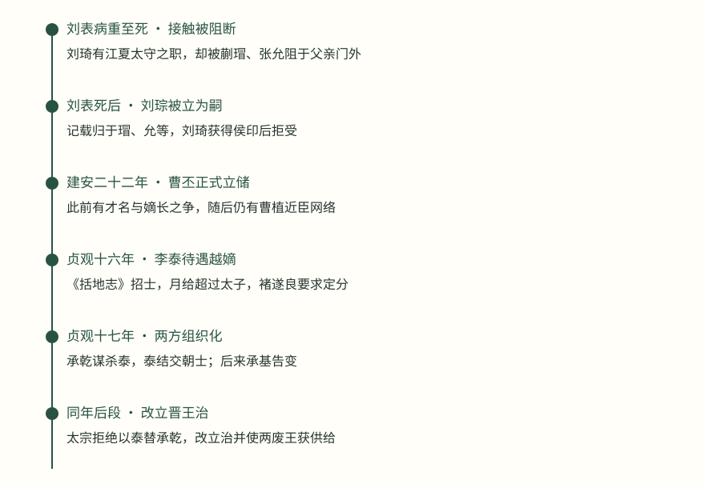
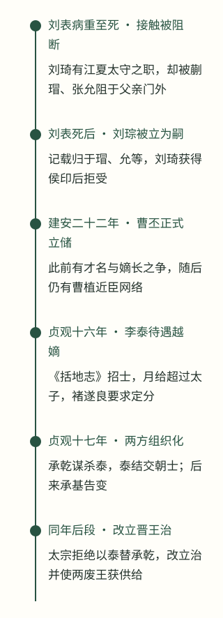
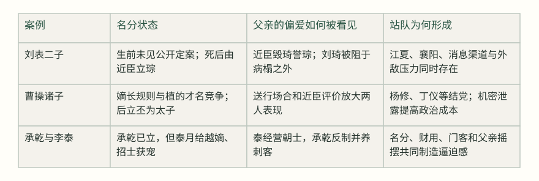
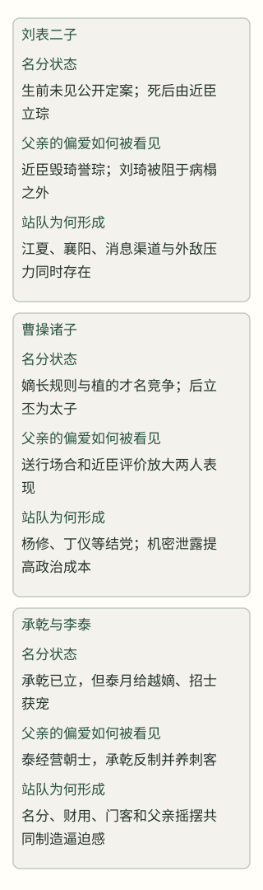

# 亲情遇上继承：偏爱为什么会把亲人推成对手？

> 从刘表二子、曹操诸子到承乾与李泰，看名分、待遇与预期如何把家事变成政治竞争

继承冲突很少只是兄弟之间争宠。真正改变局面的，是谁已经拥有名分，谁得到超出名分的资源，父亲的态度是否稳定，以及臣属是否据此押注未来。刘表、曹操和唐太宗的三段记载显示：偏爱只有在边界模糊、待遇反复和资源可以组织起来时，才会把亲情转成对手关系；而一旦站队形成，单独责怪某个儿子往往已经太晚。

贞观十六年（642年），已经立为太子的李承乾面对一个具体变化：魏王李泰主持《括地志》、广延士人，月给竟超过太子。褚遂良随即指出，庶子虽受宠爱，待遇却不应越过嫡子。此时谁面临什么问题已经很清楚：太宗要在父子亲爱与继承名分之间定界，承乾的名分是否仍有实际分量，李泰的资源增长又会被臣属如何理解。[^s1][^s7]

> 泰月给踰于太子
> — 《通鉴》卷196贞观十六年条 [^s7]

褚遂良这句话不能当作解释全部继承冲突的万能公式，却准确提出了一个观察点：爱是私人感情，待遇是公共信号。继承制度要处理的不是父亲能不能爱庶子，而是这种爱能否被转译为超过嫡子的礼秩、财用和政治位置。一旦转译发生，臣属会按照自己的风险计算站队，兄弟也会把对方的增长看成自己的损失。本文选三案，追踪的正是这条从亲情到预期、从预期到组织的链条。

## 刘表：没有公开决定，近臣就替继承写出了版本

刘表有两个儿子刘琦、刘琮。记载没有告诉我们刘表生前正式宣布了谁是继承人，却明确写出外甥张允等人“日相与毁琦而誉琮”。这不是一场单纯的兄弟性格冲突，因为评价并非在家庭内部停留，而是由接近州牧的人反复传递。刘琦因此“不自宁”，向诸葛亮求自安之术；诸葛亮先不回答，后来用申生居内、重耳居外的故事提醒他，近身的位置未必安全。[^s1]

刘琦随后请求代替战死的黄祖镇守江夏，刘表让他出任江夏太守。这个安排一方面给了刘琦一个带有地方军政资源的职位，另一方面也把他从父亲身边移开。刘表病重时，刘琦回来省疾，蒯瑁、张允却阻止他进门，理由是他擅离江夏，可能触怒父亲、加重病情。史料写的是他们怎样阻断接触，并没有证明刘表当时究竟想把继承给谁；但信息差已经形成：父亲无法直接听到儿子的解释，儿子也只能从门外的阻拦推测父亲的态度。[^s1]

> 表卒，瑁、允等遂以琮为嗣。琮以侯印授琦，琦怒，投之地，将因奔丧作难。
> — 刘表死后刘琮继立／《通鉴》卷65 [^s1]

这里要仔细区分两件事。第一，刘琮继位的直接记载发生在刘表死后，执行者是蒯瑁、张允等人；不能把它改写成刘表生前已经定案。第二，刘琦的反应也不能简单归为“被宠爱的哥哥嫉妒”。他已拥有江夏太守的职位，却在父亲病中无法进入；侯印被送到手里，意味着名分和现实权力的落差突然显现。对他而言，若接受侯印，可能等于接受自己被排除；若起兵，又会从继承竞争转成公开内战。曹操军队随后逼近，使他没有足够时间把这场争议重新谈判。

刘琮面对的选择同样不只是孝与不孝。蒯越、傅巽劝他降曹，论据包括臣拒人主的名分、荆州与曹操的强弱、刘备是否足以抵抗。刘琮接受后，却不敢及时告诉刘备，等刘备察觉，曹操已在宛城。这个延迟既可能是恐惧，也可能是既成事实下的自保；史料不能替我们确定动机，但它清楚显示，继承人的安全已经和消息控制绑在一起。[^s2][^s3]

刘表案的贡献不是证明“父亲偏爱小儿子必然酿祸”，而是展示一种更早的危险：当正式名分没有公开、父子沟通又可被近臣切断时，别人对偏爱的描述就会变成政治事实。刘琦得到江夏，刘琮得到襄阳和近臣支持；两套资源都不足以让对方自动退出。最终争议的爆发，不能只用家庭感情解释，还要把地盘、军队、消息渠道和外敌压力一起放回当时。

## 曹操：才名可以改变评价，却不能自动改写继承规则

曹操的继承竞争更清楚地呈现出三种力量：长幼与嫡庶的规则、曹植的才名、以及围绕两人的臣属网络。记载说卞氏生丕、彰、植、熊，曹植“性机警、多艺能，才藻敏赡”，曹操因此喜爱他。丁仪兄弟和杨修等人则称植之才，劝曹操立他为嗣。另一边，崔琰以春秋立长和曹丕仁孝聪明为据，毛玠、邢颙都警告以庶代宗会重蹈袁绍覆辙。这里的“偏爱”不是唯一变量，它必须通过臣属的游说才会变成废立议题。[^s4][^s6]

曹丕向贾诩询问自固之术，贾诩没有教他攻击曹植，只说应当提高德行、亲自做士人的事业、早晚勤勉而不违子道。后来曹操屏退左右再问贾诩，贾诩只说自己想到了袁绍、刘表父子。这个回答把竞争的关键从“谁更有才”移到“父亲最忌惮怎样的结局”：袁绍和刘表的继承安排，都留下了兄弟争夺的后果。曹丕据此自我约束，并不等于他没有权术，而是说明公开名分尚未确定时，行为本身会成为争取父亲信任的证据。[^s4]

> 植既任性而行，不自雕饰，五官将御之以术，矫情自饰，宫人左右并为之称说，故遂定为太子。
> — 曹丕、曹植送行后的评价／《通鉴》卷68 [^s5]

这段记载常被读成曹丕靠演技取胜、曹植输给真性情。但“故遂定”为编年史家的归纳，不能把它扩展成唯一心理因果。它至少告诉我们，曹操看到的不是两种抽象性格，而是两种公开表现：曹植在送行时称述功德、辞藻华美，曹丕则流涕而拜；左右的反应参与了父亲对二人的评价。评价不是在父子二人之间直接产生的，它经过宫人、近臣和场合礼仪的放大。[^s5]

建安二十二年曹丕被立为太子，名分由此明确。可竞争并没有马上消失。两年后，杨修、丁仪兄弟仍在谋立曹植，曹丕与吴质以装载废簏、改装绢帛的方式商议，曹操因此对杨修更加疑惧。随后史料同时写到曹植因骄纵见疏、仍与杨修相连，杨修替曹植预拟答教，曹操又以杨修泄露言教、交关诸侯为由杀之。[^s5][^s16]

这说明曹植失势不能全怪曹操偏爱某一方。父亲对才华的欣赏确实让植获得机会，植的任性和近臣网络又把机会转成风险；曹操对杨修的猜疑和对机密的重视，则给了清除网络的理由。换句话说，正式立储降低了规则不确定性，却没有立即消除资源竞争。曹植一方若继续把父亲的爱理解为可改变继承，曹丕一方就会把这种理解视为持续威胁。

## 承乾与李泰：已经立储，为什么仍然会滑向对抗？

唐太宗与李承乾、李泰的材料，把前两案中分散的因素集中到了一起。承乾已经是太子，李泰则有学问、好声名并得到父亲宠爱。贞观十六年，李泰主持《括地志》，大开馆舍、延揽士人，月给超过太子。褚遂良立即指出“尊嫡卑庶”，认为庶子受爱不能越过嫡子的用物和礼秩。这里的危险不是父亲爱李泰本身，而是李泰拥有了可见的资源与门客，足以让臣属把他当作另一个权力中心。[^s7]

太宗并非完全没有意识到问题。他一度让李泰迁居武德殿，魏征认为这座殿在东宫之西，会使人处在嫌疑之地，太宗随即让泰归第。后来太宗又以魏征为太子太师，并说废嫡立庶会危国亡家。到贞观十七年，他公开对群臣说，太子虽有足疾，仍不废步履，自己终不以庶代宗。由此可见，太宗并非一直秘密策划改立；他的政策在“宠爱和给资源”与“公开守住嫡长名分”之间摇摆，正是各方难以形成稳定预期的原因。[^s7][^s8]

承乾的问题也不能被后来的谋反一笔覆盖。史料在同一年分别记下：他在宫臣面前常谈忠孝、引咎自责，早期舆论因此称贤；又记下他奢靡、模拟突厥可汗、私养亡奴和刺客。[^s17][^s18]；前一组材料说明外界并非从一开始就一致认定他失德，后一组材料说明太子宫内部确有严重的行为问题。它们可以并存，却不能用最终结局反证早期每一项指控都已被证明。[^s9]

与此同时，李泰“见太子有足疾，潜有夺嫡之志”，折节下士，韦挺、杜楚客替他结交朝士，甚至以金钱游说权贵。[^s19]承乾则因为感到逼迫，派人伪造李泰府属的密奏[^s10]，后来又养刺客谋杀李泰。[^s18]这里的因果不能简化为“偏爱导致谋反”：李泰的经营增加了威胁的可信度，承乾的反制又把竞争从舆论和待遇推向暴力；太宗对两边的处置和态度，则不断改变双方对下一步的判断。[^s10]

> 陛下日者既立承干为太子，复宠魏王，礼秩过于承干，以成今日之祸。
> — 褚遂良论承乾、李泰／《通鉴》卷197 [^s11]

承基告变之后，承乾被废为庶人，太宗一度准备用李泰替代他。李泰向父亲表示自己今天才成为皇帝的儿子，甚至声称自己死后会杀子传位给晋王；这段话是太宗的转述，能证明太宗受到触动，不能单独证明李泰的承诺可信。褚遂良的反驳抓住了可信度问题：若李泰真据天下，谁能保证他会杀掉自己的爱子？承诺之所以危险，不是因为它一定虚假，而是因为它没有可执行的约束。[^s11]

最后太宗没有立泰，而是立晋王治，并解释说，若立泰，承乾和治都可能不保；立治，则承乾和泰都能活下来。这个决定同时处理了继承秩序和兄弟安全，却也是在承乾被废、李泰表现出夺嫡意图之后才作出的补救。后来李泰降爵、迁徙僚属，太子治又请求改善承乾和泰的衣食。亲情没有消失，但它被置于已经确定的名分和安全边界之内。[^s12][^s13][^s14][^s15]

### 图：三案中的名分与资源变化

时间线只表示事件先后；“促成风险”是本文分析，不表示单一事件充分造成后果。刘表案的继承决定记录在刘表死后；曹操案的建安二十二年正式立储与此前竞争分开；唐案把承乾已立、李泰获宠、承乾谋反和最终改立分列。[^s1][^s4][^s5][^s7][^s10][^s12]

时间线最值得注意的不是三案都出现了兄弟冲突，而是名分和资源的先后不同。刘表案先有接触与评价的竞争，后有死后继承决定；曹操案先有才名和臣属站队，后有正式立储；唐案则是正式立储在前、待遇差序在后。相同的“父亲喜爱”，放在不同顺序里，会产生不同风险：没有名分时，它制造猜测；名分已定时，它若伴随越界资源，就会制造对名分的怀疑。

### 图：偏爱何时会转成继承风险？

这是根据三案史料重建的定性比较，不是对人物动机或风险的量化评分。每一列都应与名分、资源、沟通和组织化分别核对；箭头式因果不能从单一案例直接推出。[^s1][^s4][^s7][^s10][^s11]

## 把“偏爱”拆开，才看得见真正的转折

还应注意谁承担了澄清的成本。刘表若公开说明继承安排，可能得罪一方并削弱另一方；曹操若早早公开裁决，仍要面对才名和功臣网络；太宗若只压低李泰待遇，又可能把一个受宠的儿子推成怨望者。因此，边界不是宣布一次就完成，还需要持续、可观察的执行。若规则只在冲突爆发后才出现，旁人自然会把此前的模糊当作可以下注的空间。

三案共同提醒我们，遇到继承冲突，先不要把所有现象都归结为“父亲更爱谁”。至少要分开四个问题。第一，名分是否已经公开、稳定并被实际执行；第二，待遇是否越过了名分所规定的边界；第三，谁控制父子之间的消息和见面；第四，儿子身边是否已经形成能把期待变成资源的臣属网络。刘表案的核心在第三项，曹操案突出第四项，唐案则同时具备四项。

还要把承诺放回可执行条件。李泰说自己会杀子传位，不能因为话说得动人就当作可靠方案；褚遂良的疑问其实是在问，未来的权力是否有办法约束今天的承诺。反过来，曹丕接受贾诩建议、努力维持子道，也不等于他的地位已经安全，因为曹植的才名和近臣仍能重新打开竞争。承诺、礼制和行为只有彼此一致，才会减少猜测；一项发出信号，另一项又马上抵消，猜测就会继续增长。

对于今天的读者，这些材料能提供的是观察顺序，而不是宫廷政治的处方。面对家庭中的继承、合作或资源分配争议，可以先核对公开规则和实际待遇，再看信息是否被某个中间人控制，最后问谁已经因为某种未来预期投入了不可逆的资源。核查会消耗时间，也可能让关系紧张；但不核查的代价，是等到站队和利益绑定之后，任何澄清都被解释为偏袒。古代继承案的制度、刑罚和暴力不能直接移植到现代生活，能迁移的只是把“爱不爱”拆成名分、资源、信息和可执行承诺来观察。

所以，偏爱把亲人推成对手，并不是因为亲情天然会制造敌意，而是因为亲情被允许以公共资源和继承信号的形式外溢，却没有同步建立清楚边界。刘表没有留下生前定嗣的明确记录，近臣便填补空白；曹操把才名纳入继承考量，近臣网络又使竞争持续；唐太宗已经立储，却让李泰在待遇和声望上逼近太子，在两方组织化、李泰的承诺与威胁暴露、承乾案发后[^s20]，太宗才彻底改立。真正需要警惕的转折，是私人偏爱开始改变别人对未来名分的合理预期。

## 来源与原书阅读

[^s1]: 卷65，公元208年条，本年段落16（正文）：初，刘表二子，琦、琮。外甥张允并得幸于表，日相与毁琦而誉琮。。刘表二子竞争、张允等毁誉、刘琦求自安及刘琮继嗣的关键记载。 原书：https://deewins.top/reader.html#volume-65-year--208-para-15

[^s2]: 卷65，公元208年条，本年段落17（正文）：章陵太守蒯越及东曹掾傅巽等劝刘琮降操。刘琮在曹操逼近时接受蒯越、傅巽的降曹论证。 原书：https://deewins.top/reader.html#volume-65-year--208-para-16

[^s3]: 卷65，公元208年条，本年段落18（正文）：时曹操已在宛，备乃大惊骇。刘琮未早告刘备导致消息时点改变，显示继承与信息控制相连。 原书：https://deewins.top/reader.html#volume-65-year--208-para-17

[^s4]: 卷68，公元217年条，本年段落8（正文）：植性机警、多艺能，才藻敏赡，操爱之。曹植才名、曹操喜爱以及群臣围绕嫡长和才名的竞争。 原书：https://deewins.top/reader.html#volume-68-year--217-para-7

[^s5]: 卷68，公元217年条，本年段落9（正文）：植既任性而行，不自雕饰，五官将御之以术，矫情自饰。曹丕、曹植送行表现及史家对两人表现的叙述。 原书：https://deewins.top/reader.html#volume-68-year--217-para-8

[^s6]: 卷68，公元217年条，本年段落7（正文）：魏以五官中郎将丕为太子。曹丕正式成为太子的名分节点。 原书：https://deewins.top/reader.html#volume-68-year--217-para-6

[^s7]: 卷196，公元642年条，本年段落1（正文）：魏王泰上括地志。泰好学，司马苏勖说泰，以古之贤王皆招士著书，故泰奏请修之。于是大开馆舍，广延时俊，人物辐凑，门庭如市。泰月给踰于太子。李泰主持《括地志》、招士及待遇超过太子；褚遂良提出尊嫡卑庶论。 原书：https://deewins.top/reader.html#volume-196-year--642-para-0

[^s8]: 卷196，公元642年条，本年段落12（正文）：唯太子、诸王宜有定分最急。唐太宗承认太子与诸王名分问题已成为政局要务，并以魏征辅太子。 原书：https://deewins.top/reader.html#volume-196-year--642-para-11

[^s9]: 卷196，公元643年条，本年段落16（正文）：太子承干喜声色及畋猎，所为奢靡。承乾对宫臣和私下行为的反差，以及早期舆论与后续记载并存。 原书：https://deewins.top/reader.html#volume-196-year--643-para-15

[^s10]: 卷196，公元643年条，本年段落20（正文）：魏王泰多艺能，有宠于上，见太子有足疾，潜有夺嫡之志。李泰受宠、夺嫡经营、近臣结交与承乾反制的起点。 原书：https://deewins.top/reader.html#volume-196-year--643-para-19

[^s11]: 卷197，公元643年条，本年段落6（正文）：陛下日者既立承干为太子，复宠魏王，礼秩过于承干，以成今日之祸。承乾被废后太宗欲立泰、褚遂良质疑待遇越嫡及承诺可信度。 原书：https://deewins.top/reader.html#volume-197-year--643-para-5

[^s12]: 卷197，公元643年条，本年段落7（正文）：我欲立晋王。太宗最终决定立晋王治，并在群臣面前说明三子安全的考虑。 原书：https://deewins.top/reader.html#volume-197-year--643-para-6

[^s13]: 卷197，公元643年条，本年段落8（正文）：且泰立，承干与治皆不全；治立，则承干与泰皆无恙矣。太宗对改立晋王的安全与继承秩序解释。 原书：https://deewins.top/reader.html#volume-197-year--643-para-7

[^s14]: 卷197，公元643年条，本年段落13（正文）：解魏王泰雍州牧、相州都督、左武候大将军，降爵为东莱郡王。李泰最终被降爵、削弱政治资源，僚属遭迁徙。 原书：https://deewins.top/reader.html#volume-197-year--643-para-12

[^s15]: 卷197，公元643年条，本年段落15（正文）：承干、泰衣服不过随身，饮食不能适口，幽忧可愍。新太子李治请求改善两位兄长的供给，显示改立后仍存在亲情性救济。 原书：https://deewins.top/reader.html#volume-197-year--643-para-14

[^s16]: 卷68，公元219年条，本年段落15（正文）：其后植以骄纵见疏，而植故连缀修不止，修亦不敢自绝。。曹植失势、仍与杨修相连及杨修随后因泄露言教等罪被杀。 原书：https://deewins.top/reader.html#volume-68-year--219-para-14

[^s17]: 卷196，公元643年条，本年段落17（正文）：募亡奴盗民间马牛，亲临烹煮，与所幸厮役共食之。又好效突厥语及其服饰。承乾模拟突厥可汗、募亡奴盗取马牛并在宫中行事的具体记载。 原书：https://deewins.top/reader.html#volume-196-year--643-para-16

[^s18]: 卷196，公元643年条，本年段落22（正文）：阴养刺客纥干承基等及壮士百余人，谋杀魏王泰。承乾在与李泰竞争升级后秘密养刺客并谋杀李泰。 原书：https://deewins.top/reader.html#volume-196-year--643-para-21

[^s19]: 卷196，公元643年条，本年段落20（正文）：楚客或怀金以赂权贵，因说以魏王聪明，宜为上嗣。杜楚客等替李泰结交朝士，并以金钱游说权贵立泰。 原书：https://deewins.top/reader.html#volume-196-year--643-para-19

[^s20]: 卷197，公元643年条，本年段落1（正文）：反形已具。承基告变后，审讯记载称承乾谋反的形迹已经具备，随后进入废太子处置。 原书：https://deewins.top/reader.html#volume-197-year--643-para-0
