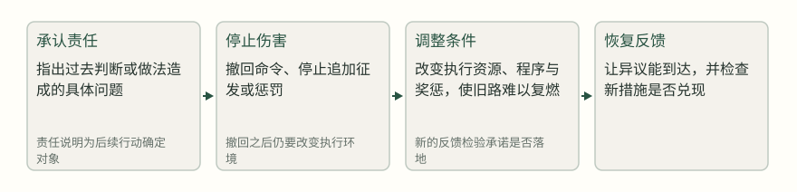
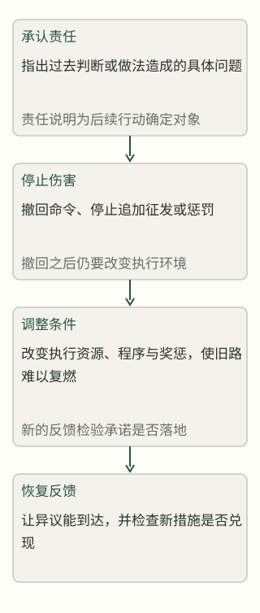
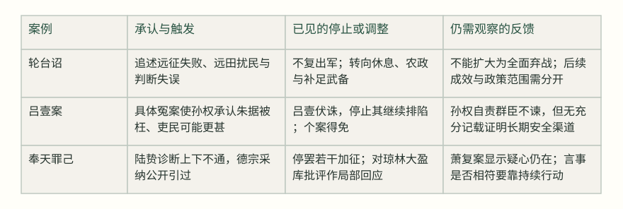
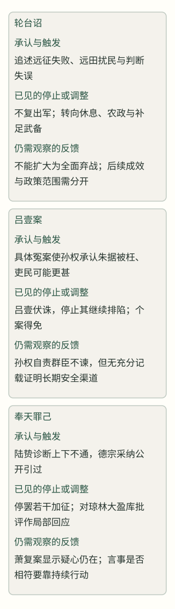

# 犯错以后：为什么认错了，事情仍然没有变好？

> 从轮台诏、吕壹案到奉天罪己，看承认如何跨过兑现与反馈的缺口

认错能改变关系，却不能自动修复造成伤害的政策、执行条件和信息渠道。汉武帝在轮台撤回远田方案，孙权诛吕壹并承认群臣不敢进谏，唐德宗在奉天由陆贽草拟罪己诏；三案共同显示，真正的补救要经受停止伤害、调整条件、恢复反馈和持续兑现的检验。

吕壹伏诛以后，孙权并没有把事情只归结为一个酷吏的问题。他通过袁礼转述自己的懊悔：自己或许“伤拒众意，忽不自觉”，而陆逊、潘浚等大臣此前为什么没有把意见说出口？这是一份已经说出的承认，却同时暴露出更难的疑问：如果造成恐惧的那套关系和程序还在，诛杀一个人之后，大臣真的就会重新开口吗？[^s7] [^s8]

《资治通鉴》里还有两个可对照的场景：汉武帝面对轮台屯田建议，唐德宗困守奉天、由陆贽推动罪己。三案都出现了“承认”或“追悔”，却分别卡在不同的环节。要问的不是谁认错得更动人，而是认错之后，哪一项伤害被停止，哪一项条件被改变，谁还能把新问题送回决策者面前。

## 认错只是入口：补救要穿过四道门

本文把“补救”作为一个逐步观察的过程，而不是一个品德标签。第一道门是承认责任：说清楚过去哪一个判断或做法造成了什么问题。第二道门是停止伤害：撤回正在继续的命令，或停止把代价追加给同一批人。第三道门是调整条件：改变预算、人员、程序、奖惩，使旧错误不会只换一种说法继续执行。第四道门是恢复反馈：让不同意见能够安全到达，使决策者可以知道新措施是否真的有效。四步不是古人列出的清单，而是依据三案重建的分析框架；箭头表示观察顺序，不表示每一步必然导致下一步。

### 图：从认错到补救：四道需要分别核验的门

分析示意。顺序帮助区分承认、停止伤害、调整条件与反馈恢复；它不把先后关系自动画成充分因果。汉武帝、孙权、德宗的材料分别落在不同门槛上，见 [^s1] [^s4] [^s8] [^s12]。

## 轮台：撤回一个方向，不等于一夜之间停止战争

汉武帝晚年面对的，是一条具体的远方经营方案。桑弘羊等人建议在轮台以东开五千顷以上的水田，派屯田卒、置校尉、筑列亭，并向西连接城障。这个建议同时包含粮食和防务的算计，也把距离、供给和民力的代价推给了更远的地方。[^s1]

> 而今又请遣卒田轮台。轮台西于车师千余里，前开陵侯击车师时，虽胜，降其王，以辽远乏食，道死者尚数千人，况益西乎！
> — 《通鉴》正文，汉武帝下诏 [^s1]

诏书的关键不在“朕后悔”三个字，而在它把新建议与先前失败放到同一条因果链里：远、缺粮、路死，意味着继续向西增设屯田并非单纯增加产量，而是把运输和守备的风险再压到士卒与百姓身上。武帝又说此前依据的“计谋、卦兆皆反缪”，并把贰师败亡的悲痛写在诏中。这里既有责任自陈，也有对既有判断依据失灵的追溯。[^s2]

但不能把这份诏书读成全面停止边战。它针对的是“又请远田轮台”和由此延伸的亭隧、募囚徒等方案；诏书同时说要“修马复令，以补缺、毋乏武备”，说明武备并未被宣布废止。接下来的编年记载是“由是不复出军”，并任命赵过改进耕作器具、教民农作。较稳妥的判断是：武帝在这一阶段收束了继续向西远征和经营的方向，把资源重心转向休息、农政与补足既有武备。它是政策撤回与条件重排，却不是所有军事行动的终结。[^s3]

这一区分很重要。假如只看到“认错”与后来民众受益，就容易把结果倒推成“认错因此成功”；但中间至少还有三步：停止新的远田与出军，任用赵过等人改变农业执行条件，以及让国家重新获得粮食与马匹。司马光后来称武帝的“趣好”发生变化，是史家评论，能帮助我们看到评价方向，却不能代替对政策范围的核对。[^s4]

## 吕壹：诛一个人，能不能让人重新敢说话？

孙权处理吕壹案，暴露的是另一种缺口。吕壹奉命校核官府与州郡文书，逐渐获得了把文书检查变成威福的空间；《通鉴》说他“深文巧诋，排陷无辜，毁短大臣”，太子孙登多次进谏，孙权没有听从，群臣于是侧目而不敢再说。这里的伤害不只是一桩冤案，而是惩罚预期改变了整个反馈系统：人人都知道出声可能被牵连，沉默就成了较安全的选择。[^s5]

是仪被指与刁嘉同罪时，材料让我们看见了“事实核验”在恐惧中的样子。他没有顺着吕壹的说法承认自己听闻过，而是在刀锯临颈的压力下说“闻知当有本末”，据实回答、辞不倾移，最后孙权放过了他，刁嘉也获免。这个局部结果说明仍有人能坚持证词，却也反过来说明普通官员为何会害怕：需要一个人在严厉诘问下承担个人风险，才能把一条不同信息保留下来。[^s6]

陆逊、潘浚为吕壹之事流泪，顾雍被吕壹诬白，朱据又因部曲受贿而被怀疑。转折发生在王遂诈取三万缗的案件：记载中的孙权是在朱据被枉、刘助查出实情的具体案情中改变判断，感叹“况吏民乎”，于是穷治吕壹之罪。这个判断有明确的触发点：不是抽象地听见众人不满，而是一个具体案件让错误归责变得可见。孙权追责吕壹，至少停止了吕壹继续制造冤狱的能力。[^s7]

> 吴主大感悟，曰：「朱据见枉，况吏民乎！」乃穷治壹罪，赏助百万。
> — 《通鉴》正文，孙权处理朱据被枉案 [^s7]

然而，惩处吕壹不等于反馈系统已经修复。吕壹伏诛以后，孙权通过袁礼转述自己的懊悔：他认为自己可能“伤拒众意，忽不自觉”，又责问陆逊、潘浚等为何没有像管仲劝齐桓公那样不断进谏。这段话显示他已经把问题从“吕壹是坏人”推进到“群臣为何不说话”，这是重要的承认；但它仍主要是孙权对臣下的要求，史料没有在此处记下一套能降低进谏风险、独立复核案件的长期安排。[^s8]

所以吕壹案不能被压缩成“领导知错，清除小人，问题解决”。它至少有三层结果：一个造成伤害的执行者被追责；一个具体的冤案被纠正；最高决策者开始意识到恐惧如何阻断信息。第三层若没有制度、程序或持续行为支撑，仍可能停在自我说明。对读者来说，观察重点是：追责之后，下一位是仪是否还敢据实回答？被误疑的人是否有更可预期的申辩路径？材料没有给出充分答案，就不能替它补上。

## 奉天：最动人的罪己诏，也要接受兑现检查

德宗在奉天的处境更险急：朱泚围城，粮尽，皇帝与群臣都面对失败后果。陆贽把此前致乱归为“上下之情不通”，主张从天下所甚欲者先行、所甚恶者先去；德宗自己则说，过去推诚时曾担心被奸人利用，也怀疑谏官道听涂说。两条材料都指向信息与信任的阻塞，但前者是陆贽的当时诊断，后者是德宗的自述，不能合并成一条未经区分的机制因果。[^s9] [^s11]

奉天的罪己不是德宗独自写出的内心独白。记载明确说，陆贽劝他“痛自引过以感人心”，德宗同意，因此奉天所下书诏让骄将悍卒都感激流涕。传播效果是《通鉴》明确记下的当时反应，但它首先说明公开话语在危局中产生了感动与劝化效果，不能直接证明叛乱已经平息或政策已经改造。这里应把“陆贽提出罪己方向”“德宗采纳并发布”“记载中的人们为之感动”三个动作分开。[^s10]

> 窃以知过非难，改过为难；言善非难，行善为难。假使赦文至精，止于知过言善，犹愿圣虑更思所难。
> — 陆贽论德宗奉天赦文 [^s12]

陆贽的补充恰好提供了本文的判断尺度：认错的语言只有在条文、资源和行动中出现，才会离开情绪层面。德宗在下一年改元赦天下，诏书说“忘己济人，不吝改过”，并宣布停罢加垫陌钱、税间架、竹木茶漆、榷铁等负担。这里存在可核对的条文调整，因而不能把奉天罪己说成纯粹表演；但这条来源首先证明诏令宣布的范围，不能单凭它证明所有项目已全面、长期退出执行。[^s13]

但兑现仍然需要第二次检查。德宗在行宫廊下设置“琼林大盈库”，陆贽认为战守之功的赏赐尚未落实，却先把贡献物品存进私库，于是上疏说军士患难与君主同忧，却未必能与君主同享。德宗最后命人去掉库名的牌子，这只能证明他对库名这一项作了名义上的回应；原文没有说库中财物已经发给军士，也没有说私库制度随之撤销。读者需要看清这次修复的尺度：它证明有纠偏动作，不能扩大为财务控制已经改变。[^s14]

萧复案进一步说明，在公开认错之后，旧的猜疑方式仍会在具体争议中出现。萧复批评宦官掌兵、指出杨炎与卢杞造成的朝政问题，德宗却因他是否借宣慰之命求留而怅恨，陆贽请求把矛盾公开辨明，德宗最终没有再辩。这里没有必要断言德宗“完全没有改变”；更准确的是，罪己诏和若干停罢措施已经发生，而萧复一案显示反馈仍可能被疑心堵住。[^s15]

陆贽后来总结得更直接：负罪的诸帅会观察皇帝“所行之事”和“所誓之言”；如果言与事相符，迁善之心才会渐渐牢固，若言事相背，疑惧就会重新兴起。这不是事后把一场成功归功于罪己。相反，它承认人们只是在观察，承诺的可信度需要时间和行为来累积；陆贽在更早的劝谏中也说，不诚于前而自称诚于后，众人必然疑而不信。[^s11]奉天之后局面能否稳定，还涉及军事将领、联盟和资源等多项因素；因此不能从后来平乱成功倒推出罪己必然奏效。[^s16]

### 图：三种认错，各自修复了哪一层？

定性比较，不是评分。表格把《通鉴》明确记载的动作与作者的解释并列；“未见充分证据”表示本文不替史料补写长期效果。见 [^s3] [^s7] [^s8] [^s13] [^s14] [^s16]。

## 把“悔过”变成可检验的行动

三案合看，认错之后最容易被忽略的是“停止什么”。轮台诏若只写悲痛而继续向轮台增屯，就没有停止伤害；它之所以更可信，是因为紧接着出现“不复出军”和农政调整。吕壹案若只诛一名酷吏而保留所有人都害怕的审问方式，追责就没有触及恐惧的来源；孙权的自责至少把这个问题说了出来，但材料不足以证明它已被解决。奉天罪己若只让人挥泪而不改税、赏、财库与听谏，传播效果也会迅速折损；德宗确有局部改动，却仍需通过后续争议接受检查。

因此，读史或观察现实中的补救，可以把四个问题分开问：被承认的错误是否指向具体行动，而非泛泛自责？造成伤害的命令是否真的停止，受影响者是否不再继续付代价？执行条件是否改变，以至于旧的错误激励不再占优势？提出坏消息的人是否更安全，意见是否能被复核而不是只靠最高者偶然醒悟？这四问不是保证成功的技巧，也不能抹平现代组织与古代政治的差异；它们只是帮助我们不把一阵感动误认成一项已经完成的修复。

还要保留一个反向提醒：过度追求完美的补救，也可能让行动永远不能开始。轮台的撤回发生在远征失败和民力困顿之后，等待全部证据齐备并不现实；吕壹案是在朱据被枉的具体事实变得可见后追责；德宗在围城压力下也必须先用诏书争取人心。核查有成本，停止一个命令也有边防和财政代价。较好的判断不是要求认错者先证明未来一切顺利，而是要求他把下一步写得足够具体，让人能够在下一次争议中检查言与事是否相符。

这也是三案最有价值的差别。汉武帝的行动告诉我们，政策转向要看范围与配套，不能把一个方向的撤回写成全面转弯；孙权的行动告诉我们，追责一个人和恢复众人的表达能力是两件事；德宗的行动告诉我们，公开承认由谁提出、怎样传播，与承诺是否兑现、反馈是否持续，必须分别核对。认错因而不是结案词，而是把责任、资源和信息重新安排之后，等待事实回来作证的开始。若只统计“说过什么”，三案都可以很快得到乐观结论；若追踪“谁因此少受了什么伤害、谁因此多获得了什么发言机会”，结论就会更窄，也更可靠。对历史人物如此，对今天的判断也应如此：先看动作，再看条件，最后看反馈是否真的回来。

## 来源与原书阅读

[^s1]: 卷22，公元前89年条，本年段落5（正文）：而今又请遣卒田轮台。轮台西于车师千余里，前开陵侯击车师时，虽胜，降其王，以辽远乏食，道死者尚数千人，况益西乎！。桑弘羊等建议轮台屯田；武帝说明远方屯田的距离、供给和死亡代价。 原书：https://deewins.top/reader.html#volume-22-year-89-para-4

[^s2]: 卷22，公元前89年条，本年段落5（正文）：今计谋、卦兆皆反缪。重合侯得虏候者，乃言『缚马者匈奴诅军事也。』。武帝追溯此前依据错误信息发动远征，并承认判断失误。 原书：https://deewins.top/reader.html#volume-22-year-89-para-4

[^s3]: 卷22，公元前89年条，本年段落6（正文）：由是不复出军，而封田千秋为富民侯，以明休息，思富养民也。。轮台诏后的阶段性停止出军和休息养民安排。 原书：https://deewins.top/reader.html#volume-22-year-89-para-5

[^s4]: 卷22，公元前89年条，本年段落7（史家评论）：此一君之身趣好殊别，而士辄应之。司马光评论武帝晚年政策趣向变化。 原书：https://deewins.top/reader.html#volume-22-year-89-para-6

[^s5]: 卷74，公元238年条，本年段落17（正文）：太子登数谏，吴主不听，群臣莫敢复言，皆畏之侧目。。吕壹排陷大臣，进谏失效，群臣因恐惧而沉默。 原书：https://deewins.top/reader.html#volume-74-year--238-para-16

[^s6]: 卷74，公元238年条，本年段落18（正文）：据实答问，辞不倾移，吴主遂舍之；嘉亦得免。。是仪在压力下据实回答，孙权随后放过是仪与刁嘉。 原书：https://deewins.top/reader.html#volume-74-year--238-para-17

[^s7]: 卷74，公元238年条，本年段落21（正文）：吴主大感悟，曰：「朱据见枉，况吏民乎！」乃穷治壹罪，赏助百万。。朱据被枉的具体事实触发孙权追责吕壹。 原书：https://deewins.top/reader.html#volume-74-year--238-para-20

[^s8]: 卷74，公元238年条，本年段落23（正文）：今孙自省无桓公之德，而诸君谏诤未出于口。孙权通过袁礼转述自责，并指出群臣此前不敢进谏。 原书：https://deewins.top/reader.html#volume-74-year--238-para-22

[^s9]: 卷229，公元783年条，本年段落24（正文）：上问陆贽以当今切务。贽以向日致乱，由上下之情不通。陆贽把危局与上下信息不通联系起来，提出先审察群情。 原书：https://deewins.top/reader.html#volume-229-year--783-para-23

[^s10]: 卷229，公元783年条，本年段落35（正文）：故奉天所下书诏，虽骄将悍卒闻之，无不感激挥涕。。陆贽建议德宗痛自引过，德宗采纳后诏书产生传播和情绪效果。 原书：https://deewins.top/reader.html#volume-229-year--783-para-34

[^s11]: 卷229，公元783年条，本年段落26（正文）：不诚于前而曰诚于后，众必疑而不信矣。。陆贽说明诚信需要前后行为相符。 原书：https://deewins.top/reader.html#volume-229-year--783-para-25

[^s12]: 卷229，公元783年条，本年段落37（正文）：知过非难，改过为难；言善非难，行善为难。。陆贽要求赦文之外落实改革条目，区分认知、言说和行动。 原书：https://deewins.top/reader.html#volume-229-year--783-para-36

[^s13]: 卷229，公元784年条，本年段落5（正文）：其所加垫陌钱、税间架、竹、本、茶、漆、榷铁之类，悉宜停罢。。德宗次年诏书停罢若干加征与专卖负担。 原书：https://deewins.top/reader.html#volume-229-year--784-para-4

[^s14]: 卷229，公元784年条，本年段落15（正文）：上即命去其牓。。陆贽批评琼林大盈库后，德宗命去掉库名牌子。 原书：https://deewins.top/reader.html#volume-229-year--784-para-14

[^s15]: 卷229，公元784年条，本年段落16（正文）：明则罔惑，辩则罔冤；惑莫甚于逆诈而不与明，冤莫痛于见疑而不与辩。。陆贽要求德宗公开辨明萧复争议，记录同时说德宗最终未再辩。 原书：https://deewins.top/reader.html#volume-229-year--784-para-15

[^s16]: 卷232，公元785年条，本年段落9（正文）：若言与事符，则迁善之心渐固；傥事与言背，则虑祸之态复兴。。陆贽说明负罪诸帅会观察德宗言行是否相符，信任需要兑现累积。 原书：https://deewins.top/reader.html#volume-232-year--785-para-8
