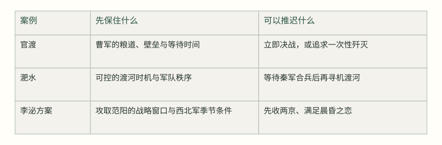
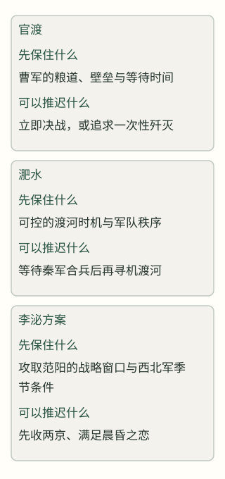
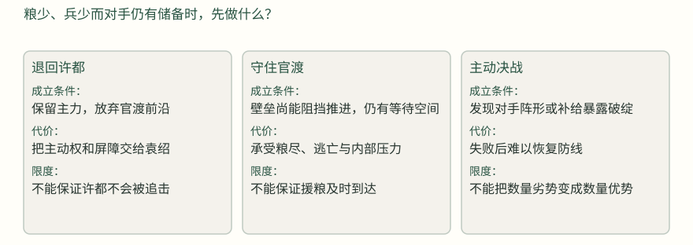
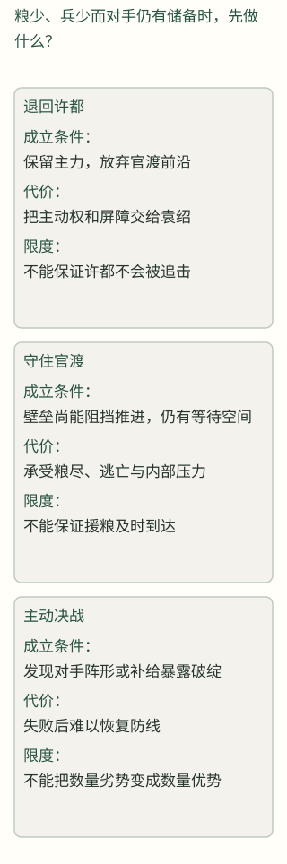
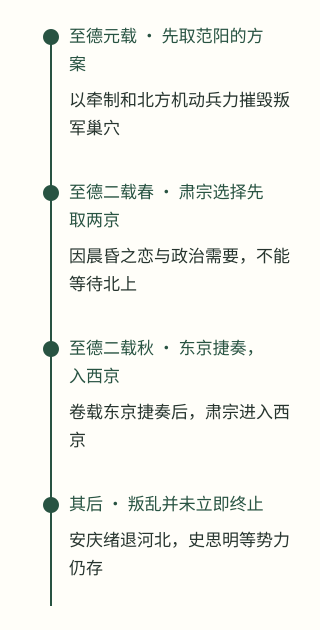
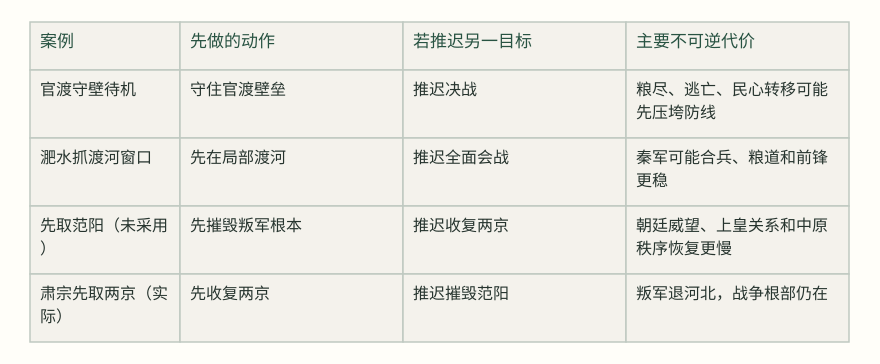
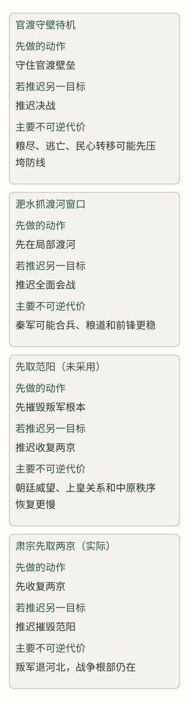

# 危机中的次序：四面告急时，究竟应该先救什么？

> 从官渡、淝水到安史之乱，看资源不足时如何保住关键约束

危机里最难的选择，通常不是判断哪件事重要，而是承认不能同时做完。官渡的曹操先守住粮道和时间，淝水的晋军抓住可渡的瞬间，李泌则主张先摧毁叛军巢穴、推迟收复两京。三案显示，次序不是沉着的别名，而是对核心约束、资源性质、政治承受力和推迟代价的判断。

## 最先传来的坏消息，不一定是最该先救的地方

官渡相持到曹操写信给荀彧时，问题已经不是要不要打一场漂亮的决战，而是曹军还能不能撑住。曹操说自己兵少、粮尽，甚至讨论退回许都；荀彧却提醒，袁绍把主力聚在官渡，若此时退却，便会把眼前唯一的屏障交给对手。这个具体选择也把三案的共同难题摆在面前：城要失守时未必立刻增兵，敌军逼近时未必立刻迎战，首都陷落时也未必能马上夺回。决定全局的约束，可能藏在粮道、阵形、季节或政治承受力里。[^s8]

### 图：三场危机首先要保住的约束

这是对史料中行动与争论的分析性归纳，不是当事人使用的量表。表中“先保”表示若该项失守，后续选择空间会显著缩小；“推迟”表示目标重要但可暂不立即完成。顺序和因果仍须结合正文核读。[^s1][^s2][^s3][^s4]

可以先把“次序”拆成四个观察项：核心约束是什么，手上的资源能不能重复使用，指挥系统能不能承受等待，推迟某个目标会带来什么不可逆损失。没有这四问，地图上的箭头很容易变成事后诸葛亮：因为最后赢了，便把当时的每一步都说成必然。下面三案的价值，正是它们给出了三种不同的优先级逻辑。[^s5]

## 官渡：曹操先保住的，是还能等到转机的前沿

建安五年，袁绍拥四州之众，曹操刚击破刘备便回到官渡。袁绍一方并非没有较稳的办法：田丰建议据险持久，分兵扰动，使曹操疲于奔命；沮授也提醒，北军粮多，南军粮少，北方有利于拖延。这个判断的关键不在于“袁绍胆小”或“曹操勇敢”，而在于双方资源结构：袁绍有数量和储备，曹操必须在许都、官渡和各处郡县之间维持一条脆弱的防线。[^s6][^s7]

> 北兵虽众而劲果不及南，南军谷少而资储不如北；南幸于急战，北利在缓师。宜徐持久，旷以日月。
> — 沮授说袁绍／《通鉴》卷六十三，建安五年条 [^s6]

袁绍没有采用持久方案，反而把军营向前推进。曹操在相持中并不占优势：记载明说曹军“众少粮尽”，士卒疲惫，百姓又因征赋而多归附袁绍。曹操甚至写信给荀彧，讨论退回许都、以退诱敌。荀彧的回答并不是保证曹操一定获胜，而是指出一旦退却，袁绍便会乘虚推进；曹操当前的壁垒已经把袁绍的庞大军队卡在官渡，关键是等到“情见势竭”。换句话说，曹操先保的不是面子，也不是一场漂亮的正面胜利，而是一个仍能让对手继续消耗的固定支点。[^s8]

### 图：官渡相持中的选择分叉（分析示意）

这是根据曹操与荀彧、袁绍与沮授等记载重建的可行选择，不表示史料列出了这张决策树。箭头不代表必然因果：各条路都依赖粮道、军心和对手反应。[^s6][^s7][^s8]

转折来自乌巢，而不是一句抽象的“坚持”。许攸投奔后指出，袁绍的粮谷集中在故市、乌巢，守备并不严密；曹操于是留下曹洪、荀攸守营，亲率五千人夜袭。袁绍面对警报，既没有把主力迅速用于救粮，也没有按照张郃“先救淳于琼”的意见行动，只派轻骑救援，同时以重兵攻曹营。曹操因此把一直被动承受的粮食问题，转成一次针对对手补给节点的局部行动。[^s9][^s10][^s11]

> 公孤军独守，外无救援而粮谷已尽，此危急之日也。袁氏辎重万余乘，在故市、乌巢，屯军无严备，若以轻兵袭之，不意而至，燔其积聚，不过三日，袁氏自败也。
> — 许攸说曹操／《通鉴》卷六十三，建安五年条 [^s9]

官渡的教训因此有两层。第一，等待不是消极动作；只有当防线、消息和少量机动力仍在，等待才会把对方的资源优势变成负担。第二，核心约束一旦明确，行动就不必平均分配力量。曹操没有同时解决所有边线，而是守住主营，把有限精锐集中到袁绍最不能承受的粮仓。这个选择仍然危险，乌巢若未被烧毁，曹军可能先被后方压力拖垮；所以它不是“以少胜多”的神话，而是以守住时间换取一次高风险打击。[^s12]

## 淝水：数量劣势下，先保住的是可渡的秩序

淝水前，前秦动员规模极大，记载称戎卒六十余万、骑二十七万，水陆运漕绵延千里；东晋能够派出的拒敌兵力约八万。若把问题只写成“少胜多”，就会跳过最关键的处境：秦军虽然庞大，却分批推进、远道深入；晋军不能在平地上用总数对总数，只能寻找一个让秦军数量暂时无法同时发挥的局部条件。[^s13]

秦军攻下寿阳后，胡彬粮尽，谢石等又因梁成屯洛涧而不敢前进。朱序本是秦的降将，他私下建议晋军趁秦军未全部会集，先击前锋；这条信息改变了晋军的选择：不是等待一支“足以对抗六十万”的援军，而是利用秦军尚未合拢的阶段。刘牢之五千精兵在洛涧击破梁成，使秦军前线的阻挡消失，也让谢石等部队得以继续推进。[^s14]

到肥水边，秦军逼水列阵，晋军无法渡河。谢玄提出让秦军稍退，使晋军渡河决战。秦军诸将认为应当堵住水面，苻坚却同意稍退、等晋军半渡再以铁骑冲击。这里的风险不是一句“轻敌”可以概括：秦军的数量优势要求维持阵形与指挥链，一旦退却使前后部队失去一致，数量本身就会变成拥挤和传令的负担。史料写的是秦兵“遂退，不可复止”，说明破坏次序先于总崩溃出现。[^s15]

> 君悬军深入，而置陈逼水，此乃持久之计，非欲速战者也。若移陈少却，使晋兵得渡，以决胜负，不亦善乎！
> — 谢玄遣使谓阳平公融／《通鉴》卷一百五，太元八年条 [^s15]

淝水的关键优先级，是先保护一支军队的秩序和一个可控的渡河时机。晋军并没有先解决秦军的全部兵力，也没有等到秦军内部完全瓦解；它先在洛涧削掉前锋屏障，再抓住秦军退却时阵形松动的瞬间。朱序在阵后呼喊“秦兵败矣”，进一步放大了混乱，但这只能解释溃败如何扩散，不能单独解释晋军为何有机会渡河。苻坚的决策、秦军远征和指挥失序，都必须留在因果链里。[^s16]

围棋故事则要放回证据强度中看。战前记载说谢安面对谢玄询问“夷然”，又出游围棋；战后记载说他读到捷报仍继续下棋，回内时“过户限，不觉屐齿之折”。这些文字确实塑造了镇定的形象，却不能证明围棋本身造成了胜利，也不能把谢安的个人表演当作前线指挥的替代。更稳妥的解释是：谢安需要让朝廷不要因恐慌改变已经部署的兵力安排；至于前线如何利用朱序、洛涧和肥水，则是谢玄、谢石等将领的军事行动。[^s17][^s18]

## 李泌：先摧毁根本，还是先满足眼前的政治任务？

安史之乱的难题比一场会战更复杂。肃宗在灵武建立行朝，郭子仪、李光弼等兵力逐渐汇集，长安与洛阳仍在叛军手中。肃宗问李泌何时可以平定，李泌没有从“收复哪一座城”回答，而是先数叛军真正能用的骁将，认为应让李光弼出井陉、郭子仪入河东，彼此牵制，使叛军将领不能自由调动；再从塞北南取范阳，断其巢穴。这个方案优先保护的是叛军根本和唐军的机动优势。[^s19]

> 今若令李光弼自太原出井陉，郭子仪自冯翊入河东，则思明、忠志不敢离范阳、常山，守忠、干真不敢离长安，
> — 李泌说肃宗／《通鉴》卷二百一十九，至德元载条 [^s19]

一年后，西北、安西、北庭和西域之兵会集，肃宗面对的是一个非常具体的选择：既然大军已经到齐，是否应乘锋直取两京。李泌再次建议先用这些“耐寒而畏暑”的兵力北上，趁新至之锐击范阳；他预计若先在春季收复两京，进入关东后天气渐热，西北军会疲惫思归，叛军则能退回巢穴、休养再来。肃宗的回答同样具体：“朕切于晨昏之恋，不能待此决矣。”这里不是听不懂战略，而是政治与家庭目标要求立即行动。[^s20]

### 图：李泌方案与实际行动的分叉

时间线把李泌提出的方案、肃宗的即时取舍和后来战果分开；方案本身不等于执行，后来的收复也不能反证原方案必然成功。日期按《通鉴》编年；“春气已深”等为史料中的季节判断。[^s19][^s20][^s21][^s29]

实际行动证明了“立即收复两京”并非没有价值：卷中记载东京捷奏后肃宗入西京，百姓出迎，朝廷重新进入长安；这恢复了朝廷的象征中心，改善了号召和任命的条件，也回应了肃宗必须面对的政治合法性问题。但它没有完成李泌所说的“根本永绝”。安庆绪退保邺郡后重新聚集河北兵众，史思明又以范阳等地为依托。这里不能简单说肃宗“错了”：他选择的是一个能迅速恢复中心、重建统治可见性的目标；代价则是战争继续，且新的作战仍需处理河北和范阳。[^s21][^s22][^s29]

这也是李泌案例最有价值的地方：它把军事次序和政治次序分开。军事上，先取范阳可能更接近消灭叛乱的长期条件；政治上，先取两京可能更有利于证明朝廷仍然存在。两种次序都不是抽象的“正确”，而是服务不同的不可逆风险。若朝廷失去两京带来的号召力，北上方案可能失去政治支撑；若先取两京却让叛军保存巢穴，军事成本就会被推迟而非消失。[^s23]

## 比较：真正要计算的是推迟的代价

三案放在一起，先保什么可以有条件地回答。官渡先保的是“还能等待的防线”：退却会立即交出屏障，所以曹操把力量集中在粮道破绽上。淝水先保的是“能让少数军队发挥作用的秩序”：晋军不能解决总数，只能让秦军在渡河处失去同时出力的条件。李泌先保的是“能让叛乱无法复生的根本”：他愿意推迟象征中心的收复，却没有得到肃宗同意。[^s24]

### 图：推迟不同目标，会失去什么？

定性比较只描述史料显示的风险结构，不给案例打分。括号内的“可能”标明作者分析；它不能替代当时决策者面对的不确定信息。[^s8][^s15][^s20][^s21]

因此，危机中的次序不是把所有事情排成一列，而是辨认哪个损失一旦发生就无法补回。官渡的粮食会耗尽，但只要壁垒和机动力尚在，仍有打击粮道的机会；淝水的渡河窗口一旦错过，秦军可能重新合拢；李泌所担心的季节优势一旦过去，西北军的耐寒条件就会改变。每案都在选择一种“会消失的机会”，同时承受另一种损失。[^s25]

还要注意，所谓“核心约束”并不总在军事地图上。官渡的许都和官渡之间，是粮道、文书和地方归附组成的政治—军事网络；曹操若只守一座营垒，却让许都失去供应，壁垒也会变成孤岛。淝水的寿阳、洛涧和肥水，则把城池、河流和先后抵达的军队连接起来，局部胜利的价值在于重新打开推进路线。李泌所说的范阳，也不仅是一座城，而是叛军财货、将领和兵源能够反复聚集的“根”。判断次序时，必须问清楚自己要保的是一个点、一条线，还是一个能持续产生力量的系统。[^s9][^s13][^s19][^s22]

三案还显示，次序判断需要允许中途改写。曹操先以防守拖住袁绍，得到乌巢情报后转为突袭；晋军先因洛涧受阻，朱序出现后改变推进节奏；肃宗也不是放弃李泌所说的根本，而是把它推迟到两京收复之后。于是“先保什么”不能在开战前写成永远有效的口号，而应随新消息、季节和资源变化重新排序。真正的稳定，不是死守第一份计划，而是能说明什么新证据足以改变次序。[^s10][^s14][^s20]

## 读者可以怎样判断下一步

面对现实中的复杂危机，历史不能直接变成战争或政治处方，但可以提供一套更具体的读法。先问：我的资源是可重复的，还是一次性窗口？官渡的五千人夜袭并不能复制成“永远集中精锐”；它依赖对方粮仓位置和守备疏忽。再问：等待会增强谁？曹操等待的是袁绍的消耗，若对手的补给反而更稳，等待就会变成自困。还要问：我想保住的是行动能力、组织合法性，还是长期根本？李泌与肃宗的争论说明，三者常常不能同时最大化。[^s26]

最后，必须把“核查”和“行动”放在同一张账上。谢玄通过朱序获得了重要信息，但他没有等到所有未知都消失才行动；曹操也不是先证明乌巢必空才出兵。相反，等待本身也有成本，尤其当粮食、季节、军心或政治信任正在消失时。较好的次序判断，不是追求全知，而是明确：哪一个未知值得用时间换，哪一个窗口一旦关闭就无法重开。[^s27]

三案最后留下的并非“先守后攻”或“先打根本”这样的万能口诀。曹操在官渡先守，最后仍需主动出击；晋军抓住渡河窗口，也必须依靠洛涧先战和前线指挥；肃宗先取两京，虽没有按李泌的长期方案推进，却获得了重建朝廷的政治空间。真正可迁移的判断是：在四面告急时，先找到会消失的条件，再计算推迟每个目标的代价；并且把战果、象征和根本分开核对，避免用最后的胜负替当时的选择补写必然性。[^s28]

## 来源与原书阅读

[^s1]: 卷63，公元200年条，本年段落4（正文）：今不如以久持之。将军据山河之固，拥四州之众，外结英雄，内修农战。田丰主张利用袁绍资源优势持久作战。 原书：https://deewins.top/reader.html#volume-63-year--200-para-3

[^s2]: 卷105，公元383年条，本年段落7（正文）：戎卒六十余万，骑二十七万，旗鼓相望，前后千里。前秦动员规模与推进范围。 原书：https://deewins.top/reader.html#volume-105-year--383-para-6

[^s3]: 卷219，公元756年条，本年段落22（正文）：覆其巢穴。贼退则无所归，留则不获安。李泌主张先取范阳、摧毁叛军根本。 原书：https://deewins.top/reader.html#volume-219-year--756-para-21

[^s4]: 卷63，公元200年条，本年段落22（正文）：公以十分居一之众，画地而守之，搤其喉而不得进，已半年矣。荀彧将官渡防守视为牵制袁绍的关键支点。 原书：https://deewins.top/reader.html#volume-63-year--200-para-21

[^s5]: 卷219，公元756年条，本年段落22（正文）：贼至则避其锋，去则乘其弊，不攻城，不遏路。李泌方案的机动与避实击虚逻辑。 原书：https://deewins.top/reader.html#volume-219-year--756-para-21

[^s6]: 卷63，公元200年条，本年段落20（正文）：北兵虽众而劲果不及南，南军谷少而资储不如北；南幸于急战，北利在缓师。沮授对双方资源和时间优势的判断。 原书：https://deewins.top/reader.html#volume-63-year--200-para-19

[^s7]: 卷63，公元200年条，本年段落8（正文）：今宜留屯延津，分兵官渡，若其克获，还迎不晚，设其有难，众弗可还。沮授建议分兵和保留回旋。 原书：https://deewins.top/reader.html#volume-63-year--200-para-7

[^s8]: 卷63，公元200年条，本年段落22（正文）：操众少粮尽，士卒疲乏，百姓困于征赋，多叛归绍者。官渡相持时曹军现实压力。 原书：https://deewins.top/reader.html#volume-63-year--200-para-21

[^s9]: 卷63，公元200年条，本年段落26（正文）：袁氏辎重万余乘，在故市、乌巢，屯军无严备。许攸提出袭击乌巢的具体情报。 原书：https://deewins.top/reader.html#volume-63-year--200-para-25

[^s10]: 卷63，公元200年条，本年段落27（正文）：曹公精兵往，必破琼等，琼等破，则事去矣，请先往救之。张郃判断乌巢危急，主张先救。 原书：https://deewins.top/reader.html#volume-63-year--200-para-26

[^s11]: 卷63，公元200年条，本年段落28（正文）：斩琼等，尽燔其粮谷。乌巢粮谷被焚，袁军随之震动。 原书：https://deewins.top/reader.html#volume-63-year--200-para-27

[^s12]: 卷63，公元200年条，本年段落33（正文）：向令田丰在此，必不至于败。。曹操本人承认若袁绍采用田丰方案，结果未必如此。 原书：https://deewins.top/reader.html#volume-63-year--200-para-32

[^s13]: 卷105，公元383年条，本年段落8（正文）：与辅国将军谢琰、西中郎将桓伊等众共八万拒之。晋军拒敌兵力与指挥部署。 原书：https://deewins.top/reader.html#volume-105-year--383-para-7

[^s14]: 卷105，公元383年条，本年段落11（正文）：今乘诸军未集，宜速击之；若败其前锋，则彼已夺气，可遂破也。朱序建议利用秦军未集、先击前锋。 原书：https://deewins.top/reader.html#volume-105-year--383-para-10

[^s15]: 卷105，公元383年条，本年段落13（正文）：秦兵遂退，不可复止。肥水退却导致秦军阵形与指挥失序。 原书：https://deewins.top/reader.html#volume-105-year--383-para-12

[^s16]: 卷105，公元383年条，本年段落13（正文）：众遂大奔。朱序喊话加速秦军溃散。 原书：https://deewins.top/reader.html#volume-105-year--383-para-12

[^s17]: 卷105，公元383年条，本年段落9（正文）：安遂命驾出游山野，亲朋毕集，与玄围棋赌墅。战前围棋叙事。 原书：https://deewins.top/reader.html#volume-105-year--383-para-8

[^s18]: 卷105，公元383年条，本年段落16（正文）：摄书置床上，了无喜色，围棋如故。战后围棋与镇定形象。 原书：https://deewins.top/reader.html#volume-105-year--383-para-15

[^s19]: 卷219，公元756年条，本年段落22（正文）：令李光弼自太原出井陉，郭子仪自冯翊入河东。李泌早期牵制和取范阳方案。 原书：https://deewins.top/reader.html#volume-219-year--756-para-21

[^s20]: 卷219，公元757年条，本年段落16（正文）：今以此众直取两京，必得之。然贼必再强，我必又困，非久安之策。李泌分析先取两京的短期成功与长期代价。 原书：https://deewins.top/reader.html#volume-219-year--757-para-15

[^s21]: 卷220，公元757年条，本年段落3（正文）：斩首六万级，填沟堑死者甚众，贼遂大溃。香积寺战后官军收复长安的军事背景。 原书：https://deewins.top/reader.html#volume-220-year--757-para-2

[^s22]: 卷220，公元757年条，本年段落27（正文）：旬日间，蔡希德自上党，田承嗣自颍川，武令珣自南阳，各帅所部兵归之。安庆绪退河北后重新聚集兵众。 原书：https://deewins.top/reader.html#volume-220-year--757-para-26

[^s23]: 卷220，公元757年条，本年段落44（正文）：沧、瀛、安、深、德、棣等州皆降，虽相州未下，河北率为唐有矣。两京收复后河北局势仍需继续处理。 原书：https://deewins.top/reader.html#volume-220-year--757-para-43

[^s24]: 卷219，公元756年条，本年段落22（正文）：彼救首则击其尾，救尾则击其首，使贼往来数千里，疲于奔命。李泌以牵制制造叛军行动成本的设计。 原书：https://deewins.top/reader.html#volume-219-year--756-para-21

[^s25]: 卷63，公元200年条，本年段落23（正文）：欲十五日为汝破绍，不复劳汝矣。曹操在粮运压力下承诺迅速解决，并随后打击运粮。 原书：https://deewins.top/reader.html#volume-63-year--200-para-22

[^s26]: 卷105，公元383年条，本年段落12（正文）：于是谢石等诸军，水陆继进。洛涧战后晋军获得推进条件。 原书：https://deewins.top/reader.html#volume-105-year--383-para-11

[^s27]: 卷220，公元757年条，本年段落7（正文）：朕始以至诚愿归万机。。肃宗对恢复两京及上皇关系的政治愿望。 原书：https://deewins.top/reader.html#volume-220-year--757-para-6

[^s28]: 卷220，公元757年条，本年段落47（正文）：且河北未平，群臣陷贼者尚多。李岘指出河北尚未平定，宽严处理与战争形势相连。 原书：https://deewins.top/reader.html#volume-220-year--757-para-46

[^s29]: 卷220，公元757年条，本年段落26（正文）：得东京捷奏。丁卯，上入西京。百姓出国门奉迎。东京捷奏后肃宗进入西京，百姓出迎，支持两京收复的直接记载及其政治象征分析。 原书：https://deewins.top/reader.html#volume-220-year--757-para-25
