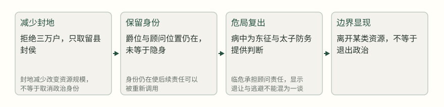
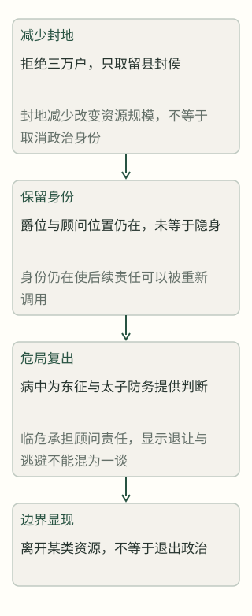
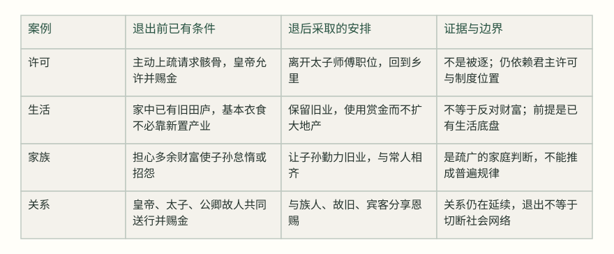
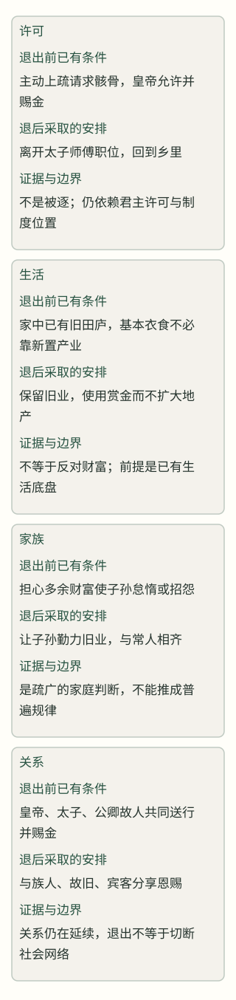
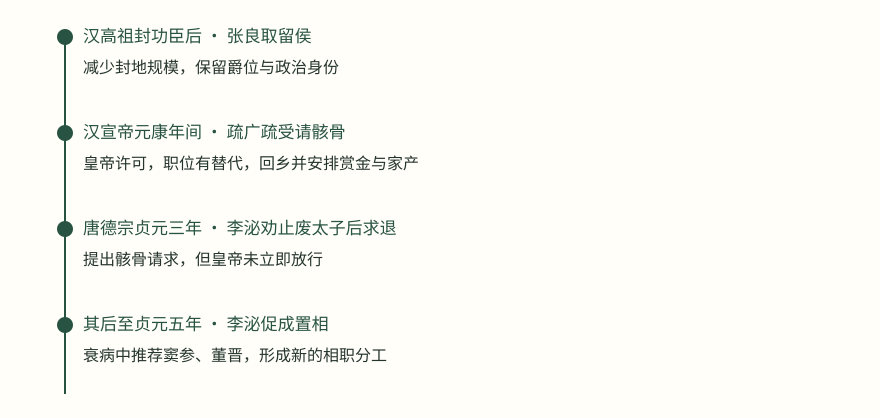
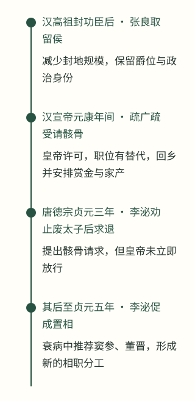

# 功成之后，什么时候该退？

> 张良、疏广疏受与李泌：离开权位不等于逃避责任，留下也不等于担当到底

张良受封时拒绝齐地三万户，只取留县；几年后，他仍在病中为刘邦和太子提供判断。这个反差把问题从一句处世格言拉回具体安排：离开之后谁来接手，生活靠什么维持，原有责任是否已经交代清楚，退一步是否真的更安全？疏广疏受把离任与家庭财产安排连在一起，李泌则在反复进退中显示申请离任和真正退出政治的不同。

刘邦分封功臣时，张良拒绝齐地三万户，只说“臣愿封留足矣”。这个选择看起来像退让，但几年后刘邦亲自东征，张良仍在病中起身，劝他不要与楚军争锋，并安排太子监护关中兵。少取封地与继续担责同时出现，说明“退”从来不是一个自动完成的动作。[^s1] [^s2]

因此，本文先把“退”拆成三层：离开一个职位，离开日常决策，退出政治网络。第一层可能只需正式许可和替代者；第三层还涉及家属安全、财富来源、旧部关系和别人是否仍把你当作资源。退得早，可能留下无人接手的责任；退得晚，也可能让职位依赖个人、使继任更难。史料能告诉我们的，是人在具体时点做了什么、拥有什么资源、面对什么风险；“这就是明哲保身”或“这一定是高风亮节”，则往往超出了证据。

## 一、张良：取少一点，不等于从此不再负责

刘邦分封功臣时，张良没有战场上的“汗马之劳”，却是谋臣。皇帝让他自己选择齐地三万户，给出的其实是很高的财富和地位。张良回答，自己在下邳起兵后与刘邦相遇，刘邦采用他的计策“幸而时中”，只愿受封留县，不敢承当三万户。最后他获得留侯爵位。这个选择减少了封地和直接资源，却保留了足够的爵位、身份与生活来源。原文没有说他从此厌弃政治，也没有说他把全部财富退回国库。[^s1]

> 臣愿封留足矣，不敢当三万户。
> — 张良／《资治通鉴》卷十一 [^s1]

这里有一个容易被忽视的边界：少取封地，不能直接证明张良已经退出政治。后来的编年记载说，刘邦东征时，张良称病仍强起到曲邮，劝皇帝不要与楚军争锋，并建议让太子统率、监护关中兵；皇帝还让他卧床辅导太子。张良此时没有再去争一个前线统帅的位置，但他仍在承担高风险决策中的顾问和太子辅导责任。[^s2]

这两处记载放在一起，能看出“离任”和“退出政治”之间的差别。张良在分封时主动缩小物质占有，可能降低了与其他功臣争功的张力，也让自己的身份不必依靠大块封地维系；但在国家仍需他判断时，他没有把减少待遇解释成不再负责。不能进一步断言这是他预先设计好的全套退隐方案，因为原文没有记载他的长期安排和内心计划。可以确认的只是：他的退让发生在资源分配环节，后续仍接受了与太子和军事安全相关的责任。

### 图：张良的两次“退”：资源收缩与责任保留

这是对两段记载的分析示意；箭头表示行动的先后，不把张良的取少直接解释为后来复出的唯一原因。张良受封见[^s1]，病中辅太子见[^s2]。

## 二、疏广疏受：真正的退出，必须安排退后的生活

疏广和侄子疏受的退出，发生在另一种场景。汉宣帝时，太子年十二，疏广任太傅，疏受任少傅。疏广对疏受说，自己听说“知足不辱，知止不殆”，现在仕宦至二千石，官位和名声已经成立，如果不离开，恐怕后来会后悔。父子当天一起请求骸骨，皇帝准许，分别赐金；太子又赠金，公卿故人设宴送行。这里“退”不是突然失势，而是在仍获信任、仍有声望时申请离任。[^s3]

但疏广的关键不在那句名言，而在退后怎样使用赏赐。回乡后，他每天叫家人卖金置办酒食，请族人、旧友和宾客共同享用。有人劝他拿金子为子孙购置产业，他回答，家中已有田庐，子孙勤劳其中，足够衣食；再增加余财，可能使子孙怠惰。贤而多财会损害志向，愚而多财会增加过失；财富又会招来众人怨恨。他也明确说这些金子是皇帝赐给退休臣子的恩惠，所以愿意与乡党宗族共享，以度余日。[^s4]

> 吾岂老誖不念子孙哉！顾自有旧田庐，令子孙勤力其中，足以共衣食，与凡人齐。
> — 疏广／《资治通鉴》卷二十五 [^s4]

这段话不必被美化成“反对一切财产”。疏广并没有把家产全部散尽，反而说明旧有田庐可以提供基本生活；他把新得的黄金转成一次性的共同宴饮和关系维护，而不是再扩张地产。它至少包含三项实际安排：有可持续的生活底盘，有对赠金的使用决定，有对家族继承风险的判断。与此同时，《通鉴》记载宣帝曾追报旧臣功劳，给其后人爵位、田宅和财物；政治恩典本来就可能成为家族生活的一部分。疏广的做法不能直接推广成适用于所有人的退休方案。[^s5] [^s16]

疏广疏受的退出也不是“离开后毫无责任”。他们以太子师傅身份离任，至少是在皇帝认可、太子另有官属的条件下离开。前一年疏广还曾反对让太子外祖家族单独监护太子家，理由是太子已有太傅、少傅，另加外戚会显得浅陋，也不利于扩充太子的德望。由此可见，他们不是厌恶所有权力，而是把师傅职责与外戚影响区分开来；退出的可行性依赖于职位替代和权力边界已经有安排。[^s6]

### 图：疏广疏受的退出为什么能够落地

定性比较依据《通鉴》关于请求骸骨、田庐、赏金与送行的记载；表中“可行条件”是作者从材料中归纳的分析，不是疏广列出的制度清单。[^s3] [^s4] [^s6]

## 三、李泌：反复进退，说明离开政治常常并不自由

李泌的经历最能打破“功成就退”的直线叙事。他在建宁王被害后与广平王约定，等京师平定就还山；这是一项危局中的退约，不是已经完成的辞官。后来他又在德宗时期重新入朝，并在皇帝怀疑太子、准备另立皇孙时，冒着触怒皇帝和牵连家族的风险力争，要求暂缓三日、查明实情。皇帝最终承认太子无罪，李泌才说“臣报国毕矣”，请求骸骨。[^s7] [^s8] [^s15]

> 陛下圣明，察太子无罪，臣报国毕矣。臣前日惊悸亡魂，不可复用，愿乞骸骨。
> — 李泌／《资治通鉴》卷二百三十三 [^s8]

这次请求与疏广不同。疏广在职位已经完成、继任结构可接受时离开；李泌是在一场高危决策刚被纠正后提出离开，理由包含身心耗损与“不可复用”的自我判断。但皇帝没有立即批准，反而希望继续倚赖他。随后李泌仍参与财政、对外关系和边防安排：他劝皇帝以制度化方式处理宫中用度，主张与回纥议和，并反复解释既有仇怨与现实利益之间的矛盾。皇帝在相当长一段时间内并未接受他的和亲主张，李泌仍继续任相。[^s9] [^s10]

这里必须区分“提出离任”和“已经退出”。李泌申请骸骨，并没有自动产生离任效果；皇帝的许可、朝廷是否找到替代者、国家是否仍在危局，决定了申请能否实现。德宗后来面对李泌衰老、独任宰相、精力耗竭的说明，仍说“未得其人”，李泌于是请求另置宰相，并推荐窦参、董晋。到他病重时，皇帝才任用这两人；三月李泌去世。这个顺序说明，一个人的退出若没有继任和权力转移，可能只是愿望，甚至会把接班问题继续拖延。[^s11] [^s12]

李泌也留下一个不应回避的限制。德宗把钱帛运入大盈库，继续私下索取，李泌听闻后“惆怅而不敢言”；司马光随后批评李泌想用增加私财来抑制皇帝欲望，结果反而可能助长欲望。这个例子表明，留下并不保证能把责任完成，退出也不自动洗去此前的政策责任。一个人若继续留任，是因为仍有不可替代的任务，还是因为权力结构找不到替代者，必须分别核对；史料不支持把李泌的每次坚持都写成纯粹成功。[^s13] [^s17]

李泌去世前的安排，还显示“找到接班人”并不只是列出两个名字。记载先说他屡次请求更换宰相，皇帝以“未得其人”拒绝；后来李泌病重，又推荐窦参、董晋，朝廷才分别给他们中书、门下和度支等具体职务。也就是说，替代者要被放进实际的权力分工，才能承担原先由一人集中处理的事务。李泌最终在这一安排之后去世，史家仍称其有谋略而又好谈神仙诡诞，说明一个人的政治遗产可以同时包含有效判断与可受批评的部分。[^s12] [^s14]

### 图：三种退出路径：缩小资源、获准离任、请求而未立即离任

时间线按《通鉴》编年位置排列；李泌前后两次退意与入朝经历并非一条连续的隐退过程。事件先后可核对[^s1] [^s3] [^s8] [^s11] [^s12]，图中只表示记载的行动顺序，不暗示古代存在统一的任期制度。

## 四、什么时候“退”才真正可行？

三案比较后，问题可以改写成四个相互牵制的检查点。第一，责任是否已经完成，或者至少已经从“必须由我处理”变成“别人可以接手”？张良减少封地，却在太子和关中兵务需要时继续提供判断；疏广离开太子师傅，是在皇帝认可并已有师傅官属的背景下；李泌在太子危机后申请离任，却因为继任不足而继续留下。离开职位与交代责任，不是同一个动作。

还要问，所谓“功成”究竟是哪一项功成。张良完成的是一项封赏选择，却没有因此完成汉廷所有用人和军事责任；疏广完成太子教育阶段的职责，却仍需处理退后家庭与乡里的关系；李泌说“报国毕矣”，指向的是眼前太子危机被纠正，并不等于国家所有危局都已结束。若把局部任务完成误写成全部责任结束，退就会显得比史料更彻底，留下也会显得比实际更贪恋权位。

第二，退后的生活资源是否清楚。疏广的说法尤其具体：旧田庐提供底盘，赏金有明确用途，子孙不靠新增产业。张良的留侯封爵也构成一种合法生活来源。李泌则是高位宰相，退后如何生活、家族如何安置，记载没有像疏广那样展开；正因为材料不足，不能把他的请求拔高成一套已经完成的生活规划。没有资源安排的“退出”，可能只是把压力转移给家人、门生或旧部。

第三，许可与替代是否成立。在君主制政治中，主动请求骸骨不是单方面辞职；疏广获准，李泌未即时获准，差别直接改变了行动结果。即便现代制度下个人有更强的离职自主权，也仍要核对合同、交接、团队和受影响者。古代君臣关系不能直接当作现代职业处方，但“我想走”与“系统能够承受我走”之间的差距，仍是这三案共同呈现的结构问题。

第四，退后是否真的降低风险。张良保留身份，因而仍会被召回承担责任；疏广回乡，依靠旧业和乡党关系生活，却没有与所有社会关系切断；李泌多次进退，说明离开宫廷未必安全，留下也未必更安全。所谓“明哲保身”若只看是否离开，就会遗漏新的风险：退后仍可能被视为政治资源，家族仍可能受牵连，继任者也可能因权力真空而制造新冲突。

因此，判断退与不退不能靠一句“知止”或“再坚持一下”。可以观察的是：眼前任务有没有替代路径，继任者是否已经被授予实际权限，生活来源是否不必重新依附原职位，家族和旧部是否知道权力边界，退出后仍需承担的责任是否写清楚。每一项核对都有成本，等待交接可能错过时机，提前离开也可能使责任断裂；这些成本不能被漂亮的道德语言抹掉。

还应把“退后继续帮忙”与“退后继续掌权”分开。张良以顾问身份被重新询问，并不等于他继续控制全部封国事务；疏广与乡党、故旧共享赏赐，也不等于保留朝廷任命权；李泌推荐继任者，是为了缓解独任宰相的风险，也不是证明他已经获得无条件的退休许可。退出后的影响力可能是经验、声望或关系网络，若没有清楚边界，它也可能重新变成一种权力。

《资治通鉴》里的“退”最终不是姿态，而是关系、资源和责任的重新排列。张良告诉我们，减少所得可以与继续担责并存；疏广疏受告诉我们，离任之后的生活与家族安排决定退出能否持续；李泌告诉我们，在危局中申请离开并不等于已经获得离开的条件。真正可行的退出，至少要让三件事同时变得清楚：谁接手，靠什么生活，还欠下什么责任。三者没有准备好时，留下可能是必要的承担，也可能只是替代安排迟迟没有出现；三者逐步具备时，离开职位才可能成为对公共事务负责的一部分。这个结论不保证退后平安，也不把留下自动视为忠诚；它只要求把选择的条件和代价一一说清。

## 来源与原书阅读

[^s1]: 卷11，公元前201年条，本年段落6（正文）：张良为谋臣，亦无战斗功；帝使自择齐三万户。。张良在分封时拒绝三万户，只取留县封侯；说明减少资源但保留合法身份。 原书：https://deewins.top/reader.html#volume-11-year-201-para-5

[^s2]: 卷12，公元前196年条，本年段落21（正文）：留侯病，自强起，至曲邮。张良病中仍为东征和太子、关中防务提供建议。 原书：https://deewins.top/reader.html#volume-12-year-196-para-20

[^s3]: 卷25，公元前63年条，本年段落5（正文）：太傅疏广谓少傅受曰。疏广、疏受在仍获信任时请求骸骨并获准，且有赏赐和送行。 原书：https://deewins.top/reader.html#volume-25-year-63-para-4

[^s4]: 卷25，公元前63年条，本年段落6（正文）：广、受归乡里，日令其家卖金共具，请族人、故旧、宾客，与相娱乐。。疏广具体安排赏金、旧田庐和子孙生活，并拒绝用新金扩张产业。 原书：https://deewins.top/reader.html#volume-25-year-63-para-5

[^s5]: 卷25，公元前63年条，本年段落6（正文）：又此金者，圣主所以惠养它臣也，故乐与乡党、宗族共飨其赐。疏广将财富、家教、乡党关系与退休生活放在一起考虑。 原书：https://deewins.top/reader.html#volume-25-year-63-para-5

[^s6]: 卷25，公元前67年条，本年段落6（正文）：太子自有太傅、少傅，官属已备，今复使舜护太子家，示陋，非所以广太子德于天下也。。疏广曾明确区分太子师傅职责与外戚监护，说明其退出依赖职位边界和替代结构。 原书：https://deewins.top/reader.html#volume-25-year-67-para-5

[^s7]: 卷219，公元757年条，本年段落4（正文）：泌曰：「不可，王不见建宁之祸乎﹖」俶曰：「窃为先生忧之。」泌曰：「泌与主上有约矣。俟平京师，则去还山，庶免于患。。李泌曾把平定京师后离开、还山作为与皇帝的约定。 原书：https://deewins.top/reader.html#volume-219-year--757-para-3

[^s8]: 卷233，公元787年条，本年段落7（正文）：泌拜贺，因曰：「陛下圣明，察太子无罪，臣报国毕矣。臣前日惊悸亡魂，。李泌在劝止废太子后请求骸骨，但其请求发生在高风险决策刚结束之际。 原书：https://deewins.top/reader.html#volume-233-year--787-para-6

[^s9]: 卷233，公元787年条，本年段落9（正文）：今请岁供宫中钱百万缗。李泌仍在任时尝试把宫中用度改为制度化供给。 原书：https://deewins.top/reader.html#volume-233-year--787-para-8

[^s10]: 卷233，公元787年条，本年段落10（正文）：自是泌凡十五余对，未尝不论回纥事，上终不许。。李泌在反复劝说未被采纳后再次请求离任，但仍未即时离开。 原书：https://deewins.top/reader.html#volume-233-year--787-para-9

[^s11]: 卷233，公元788年条，本年段落8（正文）：泌自陈衰老，独任宰相。李泌的离任愿望受制于皇帝找不到替代者，遂转为请求增置宰相。 原书：https://deewins.top/reader.html#volume-233-year--788-para-7

[^s12]: 卷233，公元789年条，本年段落3（正文）：至是泌疾甚，复荐二人。庚子，以董晋为门下侍郎，窦参为中书侍郎兼度支转运使，并同平章事。。李泌病重时推荐董晋、窦参，朝廷据此形成新的相职安排。 原书：https://deewins.top/reader.html#volume-233-year--789-para-2

[^s13]: 卷233，公元788年条，本年段落5（正文）：元友直运淮南钱帛二十万至长安，李泌悉输之大盈库。然上犹数有宣索，仍敕诸道勿令宰相知。泌闻之。惆怅而不敢言。。李泌在财政问题上并非始终能纠正皇帝行为，且曾不敢进言。 原书：https://deewins.top/reader.html#volume-233-year--788-para-4

[^s14]: 卷233，公元789年条，本年段落5（正文）：三月，甲辰，李泌薨。。李泌最终在病重推荐继任之后去世。 原书：https://deewins.top/reader.html#volume-233-year--789-para-4

[^s15]: 卷220，公元757年条，本年段落23（正文）：泌求归山不已，上固留之，不能得，乃听归衡山。。李泌后来反复请求归山，皇帝最终听许，明确显示约定退山与实际获准离任之间的差别。 原书：https://deewins.top/reader.html#volume-220-year--757-para-22

[^s16]: 卷25，公元前63年条，本年段落2（正文）：故掖庭令张贺，辅导朕躬，修文学经术，恩惠卓异，厥功茂焉。。宣帝追报旧臣张贺及其后人，说明政治恩典可能延伸到家族生活。 原书：https://deewins.top/reader.html#volume-25-year-63-para-1

[^s17]: 卷233，公元788年条，本年段落6（史家评论）：李泌欲弭德宗之欲而丰其私财，财丰则欲滋矣。。司马光批评李泌以增加私财抑制德宗欲望的政策思路。 原书：https://deewins.top/reader.html#volume-233-year--788-para-5
