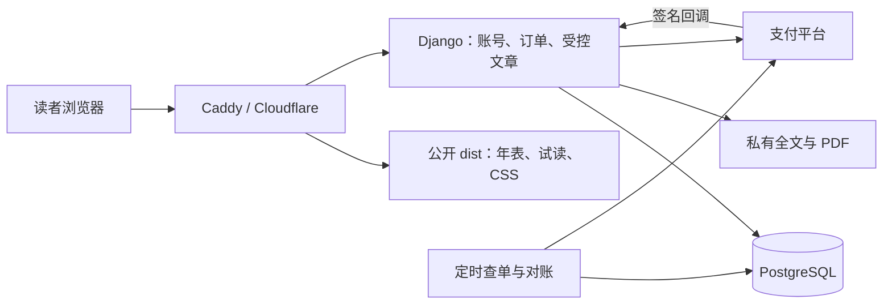

# 通鉴年鉴付费功能：开发规划与实施步骤

编写日期：2026-10-14。适用项目：`/home/linqp/projs/tongjian`。

2026-10-15 用户修订：账号流程改为独立的邮箱注册、密码登录和邮件找回密码。注册须向填写的邮箱发送验证码，提交正确验证码与密码/确认密码后才创建账号；以后使用邮箱密码登录，取代“验证码自动注册/登录”。旧验证码账号可通过邮件设置密码并保留原账号、订单和权益。本文以下验证码登录规划保留为原始背景，以本条最新要求和实施报告为准。

状态（2026-10-15）：已依本方案实施本地后端、内容保护、账号、订单/退款、微信 Native/H5 接入代码及运维配置，正在完成验收记录。商户、SMTP、正式价格/条款及公网发布条件未确认，尚未真实收款或发布。实际进度见 [实施与验收报告](paid-content-implementation.md)，运行方式见 [后端手册](../backend/README.md)。下文保留原开发目标和阶段定义，规划中的外部关卡不因本地测试通过而自动完成。

## 1. 开发目标与第一期边界

第一期实现一个完整的交易闭环：**读者试读专题 → 登录 → 购买 → 后端确认收款 → 阅读全文和下载 PDF → 以后登录重读 → 必要时退款**。

建议以“判断真伪 / 先别急着相信”为首个商品，采用单篇一次性购买，包含专题全文和现有配套 PDF。这是开发默认方案，价格、正式售卖范围和退款条款必须在上线前由站点负责人确定，不把规划建议当作已确认的商业承诺。

第一期包含：

- 一个商品、一种已开通的支付渠道，覆盖桌面和选定的手机浏览器。
- 邮箱验证码登录、退出、跨设备查看已购内容。
- 免费试读、购买页、付款状态页、受控全文和 PDF 下载。
- 商品管理、订单查询、人工补发、全额退款和操作记录。
- 支付回调、主动查单、幂等发货、自动补偿、每日对账。
- 受控发布、备份恢复和异常情况下停止下单。

订阅、自动续费、会员等级、优惠券、分销、积分、购物车和多商品合单放到后续版本。付费开发不改动通鉴卷数据、年排序键、白话对齐和原文来源；维持现有年表及原文阅读入口。上传现代译文和外部转载资料不默认进入商品，商业使用范围另行核实。

## 2. 当前项目事实与需要改动的位置

以下事实来自本地文件检查；服务器现状依据项目发布文档，未在本次连接服务器核验。

| 现状 | 文件或位置 | 对实施的影响 |
| --- | --- | --- |
| 网站是无前端构建的静态站 | `dist/`、`README.md` | 保留现有 HTML/CSS/JS，新增独立后端 |
| 专题入口直接链接文章 | `dist/research.html` | 卡片新增免费/付费/已购状态和价格 |
| 判断真伪全文已在公开 HTML 中 | `dist/truth.html` | 原地址改成试读页，完整内容移到私有目录 |
| 全文含六案、表格、内嵌 SVG、出处链接 | `dist/truth.html`、`dist/truth-article.css` | 复用现有排版和段落锚点，不重新改写文章 |
| 已有 PDF，当前未放进静态目录 | `output/pdf/tongjian-truth-reader.pdf` | 后端受控交付，禁止复制到 `dist/` |
| 生成脚本默认输出公开全文 | `artifacts/monetization/build_pdf_article.py` | 必须改造输出路径，否则重建会重新暴露全文 |
| 存在全文与源稿副本 | `artifacts/monetization/truth-article.html`、`truth-pack-content.json`、稿件 Markdown | 保留为私有构建输入，不随站点发布 |
| 现有全书搜索读取公开分卷索引 | `dist/search-worker.js`、`dist/search*.json` | 第一期开通鉴搜索不变，禁止加入付费分析全文 |
| 没有账号、数据库、订单和支付服务 | 当前 `requirements.txt` 与应用文件 | 后端与交易设施需要新建 |
| 发布文档记录 Caddy 静态服务和 Cloudflare | `.agents/skills/develop-tongjian/references/server-deployment.md` | 新增反代及缓存规则，保留其他站点配置 |
| 有阅读器逻辑和真实浏览器检查范式 | `scripts/check_reader.cjs`、`scripts/check_people_browser.py`、专题 QA 资料 | 分别做交易测试、浏览器验收和既有阅读回归 |

既有公开全文可能已被下载或缓存。付费迁移只能控制迁移后的服务器交付，不能撤回读者已有副本。上线时需要清除可控制的 CDN 旧缓存和线上公开副本；商品价值与宣传不能建立在“此前从未公开”这一假设上。

## 3. 开工条件、默认决策与上线关卡

### 3.1 需要站点负责人确定的商业规则

开发开始时建立 `docs/paid-content-launch-decisions.md`，记录以下决定、日期和负责人。该文件是后续实施产物，本次没有代填商业决定。

| 决定 | 开发默认值 | 必须确定的时点 |
| --- | --- | --- |
| 首个商品 | 判断真伪全文 + 配套 PDF | 内容迁移前 |
| 商品价格 | 无默认价格；本地测试使用明确标记的测试价格 | 真实收款前 |
| 试读范围 | 导语、目录及第一案，按章节白名单生成 | 内容迁移前 |
| 访问期限 | 权益不自动到期；实际服务期限由条款说明 | 商品上架前 |
| 更新范围 | 同一商品勘误不重复收费；新专题另售 | 商品上架前 |
| 退款政策 | 支持后台全额退款；具体受理条件、联系渠道待确定 | 商品上架前 |
| 售卖与收款主体 | 以实际签约主体为准 | 支付接入前 |
| 登录方式 | 邮箱一次性验证码，不要求绑定微信 | 账号开发前 |
| 手机付款范围 | 普通浏览器付款；微信内付款视 JSAPI 条件另定 | 渠道选择时 |
| 管理员访问 | 固定可信出口 IP allowlist；没有固定出口时配置并验证 VPN 入口 | P0 记录真实允许网段/访问方式，P6 验收 |

没有支付资质或密钥时，仍可开发本地模拟渠道、账号、内容保护和订单测试；不能因此把模拟完成记为可真实收款。

### 3.2 支付渠道选择必须先过 G0

第一期“一种渠道”指一家支付服务商，不是只做一种支付场景。不能用桌面二维码代替手机付款能力。

| 使用场景 | 微信可用产品 | 已核实的主要条件 | 第一期开通策略 |
| --- | --- | --- | --- |
| 桌面浏览器 | Native | 支持 PC 网页扫码；需正式商户及产品权限 | 可作为桌面方案 |
| 手机 Safari / Chrome 等普通浏览器 | H5 | 明确不适用于微信内部浏览器；主体与支付域名须符合申请要求 | 企业等符合条件的主体申请后接入 |
| 微信内部浏览器 | JSAPI | 需符合条件的已认证服务号/公众号、绑定关系、支付权限及用户 OpenID | 条件齐备才纳入第一期，否则引导到外部浏览器 |
| 桌面 + 普通手机浏览器 | 支付宝电脑网站 + 手机网站支付 | 主体、应用、类目、域名与产品签约以当前商户后台审核为准 | 微信手机方案不具备时，优先评估这个组合 |

微信官方 Native 文档明确不支持相册识别或长按识别。因此“手机上显示二维码，让用户保存后识别”不作为正式手机购买方案。微信 H5 官方当前列出的适用主体不包含个体工商户；个体工商户不能据 Native 可申请就推定 H5 也可申请。

G0 的交付是渠道选择记录和能力矩阵，至少包含：

1. 实际收款主体、商户号/应用的产品开通状态，数字内容类目是否可受理。
2. `deewins.top` 的域名、备案/授权材料是否满足该渠道当前申请要求；现有服务器所在地不能替代此项核验。
3. 桌面、普通手机、微信内浏览器分别怎样付款或怎样引导。
4. 回调域名、支付返回域名、退款权限和对账权限。
5. 商户后台确认结果的日期；记录状态即可，不把密钥、证件和个人资料提交到 Git。

推荐分支：企业等主体具备微信 H5 + Native 条件时采用微信；仅具备其他主体条件时先验证支付宝网页产品或 JSAPI 方案。没有一家官方渠道满足目标设备范围时，停留在本地/测试环境，先解决签约或缩小并明确试运营范围，不接个人收款码自动解锁。

### 3.3 非支付的外部依赖

| 依赖 | 核验方法 | 未满足时的处理 |
| --- | --- | --- |
| 发信服务和发信域名 | 配置 SPF/DKIM，实际向目标读者常用邮箱发验证码，记录到达时间与失败 | 本地使用测试邮件后端；生产登录不开通 |
| 服务器容量与网络 | 后续部署前读取实际 OS、Python、内存、磁盘、端口与服务清单；验证向支付 API/发信服务的出站连接 | 调整部署资源或服务，不凭本机环境推定服务器可运行 |
| 支付回调公网可达 | 从外网 IPv4/IPv6 和支付平台实际通知验证 HTTPS、证书和路由 | 未核验前不开真实下单；SSH 走 IPv6 不等于回调可达 |
| Cloudflare 设置 | 检查回调无验证码/浏览器挑战，私有路径不被 Cache Everything 缓存 | 精确调整相应路径，不关闭全站防护 |
| 内容使用与售后 | 首个商品逐项核对来源、授权范围、版本、服务条款、隐私说明和联系人 | 条款或内容范围未确定则不售卖 |

## 4. 技术方案与服务边界

### 4.1 固定第一期实现路线

- 后端：Python 3.12 + Django 5.2 LTS 的实施时最新安全补丁；依赖锁定到实际验证过的版本。
- 数据库：PostgreSQL 16 的受支持补丁版本，开发测试也使用 PostgreSQL。
- Web 服务：Gunicorn，由 systemd 管理，只监听 `127.0.0.1:8010`。
- 前端：现有静态页面 + 小型 `commerce.js`；账号、结算、完整文章用 Django 模板渲染。
- 管理：复用 Django admin，不另造商城管理界面。
- 后台任务：Django management commands + systemd timers，先不引入 Redis、Celery 或微服务。
- 支付：统一 adapter 接口，第一期只启用 G0 选定的真实渠道和仅测试可用的 fake adapter。

本地 Python 当前为 3.12.13。服务器版本尚未核实。新增后端依赖放在 `backend/` 的独立锁文件中，不把 Django/支付依赖混入现有 EPUB 工具的 `requirements.txt`。

### 4.2 请求与内容流向



公开静态资源仍从 `/tongjian/` 提供。动态请求保留完整 `/tongjian/` 前缀转发给 Django；避免同时在 Caddy 和 Django 中重复剥离或添加前缀。

| 地址 | 实现与缓存 |
| --- | --- |
| `/tongjian/research.html`、`/tongjian/truth.html` | 公开专题目录和试读页；`truth.html` 保留旧入口 |
| `/tongjian/api/v1/products/truth/` | 只返回公开商品元数据与当前价格，可短时缓存，不包含已购状态 |
| `/tongjian/api/v1/healthz/` | 简要健康检查，由 API 动态路由转发；不另设 `/tongjian/healthz` |
| `/tongjian/api/v1/session/`、`/tongjian/api/v1/me/purchases/` | 登录/购买状态，`private, no-store` |
| `/tongjian/account/…` | 登录、退出、已购页面，`private, no-store` |
| `/tongjian/checkout/<order_id>/` | 订单所属用户的支付页，`private, no-store` |
| `/tongjian/article/truth/` | 后端逐次检查权益后渲染全文，`private, no-store` |
| `/tongjian/api/v1/products/truth/download/` | 后端检查权益后流式返回 PDF，`private, no-store` |
| `/tongjian/admin/` | 管理后台，限制来源并要求管理员登录，不公开注册管理员 |

账号、文章、支付页和 API 的 Cookie 路径统一 `/tongjian/`。API 不启用跨域；静态试读中的 fetch 使用同源 Cookie。付费正文不经公开对象存储 URL，也不依赖可转发的长期下载链接。第一期直接受控返回现有小体积 PDF，减少签名链接和对象存储复杂度。

### 4.3 后续创建的目录

以下是实施目标，除现有条目外目前尚不存在，不应把这些路径当作已完成的代码。

```text
backend/
  manage.py
  requirements.in / requirements.lock
  config/                     # settings、urls、wsgi
  accounts/                   # 用户、验证码、会话
  commerce/                   # 商品、订单、权益、退款、admin
  payments/                   # adapter、回调、查单、对账
  templates/                  # 账号、结算、完整文章
  tests/                      # PostgreSQL 交易与权限测试
  .env.example                # 只有配置键和无效占位值
content/products/truth/
  manifest.json               # 商品、版本、试读章节白名单、校验值
private-content/truth/<version>/
  article.html                # 已核对完整正文片段
  reader.pdf                  # 已核对 PDF
dist/commerce.js / commerce.css
scripts/build_paid_content.py
scripts/check_paid_content_public.py
scripts/check_commerce_browser.py
ops/commerce/                 # systemd 单元、路由片段、备份/恢复说明
```

`private-content/`、`.venv-commerce/`、真实 `.env`、密钥、数据库备份和验证码相关敏感测试产物加入 `.gitignore`。正文源稿如何备份与是否进入私有仓库另行记录；公开 Git 仓库不能当作内容保护边界。发布脚本只发送明确列出的公开文件、后端代码与独立私有内容，不能将整个项目根目录设为 `file_server` 根目录。

## 5. 数据模型、权益与状态机

### 5.1 最小数据模型

| 模型 | 主要字段与约束 |
| --- | --- |
| User | UUID、规范化邮箱唯一、active/staff；在首次迁移前设定自定义 `AUTH_USER_MODEL` |
| EmailChallenge | 邮箱、验证码 HMAC 摘要、过期/消费时间、失败次数、发信状态；不保存明文验证码 |
| RateLimitBucket | 邮箱/IP/IP 段/全局作用域、时间窗、计数、到期时间；作用域 + 时间窗唯一，事务内更新 |
| Product | 唯一 slug、标题、状态、价格分、币种 CNY、当前内容版本、商品条款版本 |
| ContentVersion | 商品、版本号、HTML/PDF 校验值、文件位置、发布时间；版本唯一且发布后不可原位覆盖 |
| Order | UUID、唯一商户订单号、user/product、金额及名称/内容/条款快照、支付渠道与场景、状态、过期时间、幂等键 |
| Payment | 订单、渠道交易号、实际金额、已确认状态、确认时间；渠道 + 交易号唯一 |
| AccessGrant | 用户、商品、来源订单或人工授予记录、active/revoked；一个来源不能重复授予 |
| Refund | 唯一商户退款号、订单、金额、requested/processing/succeeded/failed、渠道退款号、结果时间 |
| PaymentEvent | 渠道事件标识/摘要、交易号、验证/处理结果、时间；去重键唯一，敏感原报文限期保留或脱敏 |
| AuditLog | 操作者、操作、对象、原因、前后状态、时间；补发和退款必须留痕 |

所有金额使用整数分，不用浮点数。服务端取商品价格；前端提交 slug、商品修订号和支付场景，不提交可被信任的金额。商品价格变化时重新确认，不能默默按新价格扣款。数据库存 UTC 时间，用户显示按北京时间。

权益判断为“当前用户对当前商品至少有一条有效 AccessGrant”。退款只撤销该订单对应的 grant，不撤销其他有效购买或人工授予。即使意外重复付款，也保留两笔真实支付及各自来源，不静默吞单；后台提示人工处理重复购买。

### 5.2 订单和退款分别管理

订单主状态：`PENDING → PAID`，或经渠道查单/关单确认后 `PENDING → CLOSED`。退款状态单独记录，不用一个 `status` 同时表达收款和退款事实。

| 触发 | 处理 |
| --- | --- |
| 创建订单 | 保存价格快照及唯一商户单号，再请求渠道；外部请求不长时间占用数据库行锁 |
| 下单接口超时 | 订单保持待确认；按原商户单号查单/重试，不直接生成新的收款单 |
| 收到已验签且金额、商户和交易状态一致的成功通知 | 行锁 + 事务写 Payment、更新 Order、授予 grant |
| 前端返回“成功”或用户上传付款截图 | 只触发后端查单，不授予权益 |
| 回调重复，或查单与回调同时确认 | 同一个确认函数和数据库约束去重，仅授予一次 |
| 本地超过过期时间 | 先查单，再按渠道语义关单；结果不明时保持待确认，不只按本地时钟关闭 |
| 已记为 CLOSED 后收到可核实的支付成功 | 再查单核验，以真实收款为准纠正状态并补发；留异常记录 |
| 请求全额退款 | 记录退款号、金额、操作者；同一订单只允许一个未决退款请求 |
| 渠道接受退款申请 | 状态为 processing，暂不撤销权益 |
| 退款最终确认成功 | 标记 succeeded 并撤销该来源 grant；已下载副本无法撤回 |
| 退款失败/异常/结果未知 | 保留权益、查退款并报警，使用原退款号重试或人工处理 |

订单创建幂等键按用户作用域唯一并绑定请求摘要；同键不同请求返回 409。已购用户默认不再创建新订单。用户已有未决订单时返回原订单，支付场景切换需要先确认旧单已关闭；多标签页并发下单用 PostgreSQL 事务和约束验证。

支付确认和退款确认统一以订单为串行化对象，锁顺序一致，避免退款已成功后迟到的支付回调再次激活权益。历史事实可追加，已确认状态不能被较旧事件倒退覆盖。

### 5.3 支付安全与补偿任务

微信接入验证通知签名、可信公钥/证书序列号与轮换、通知解密、商户号、AppID、订单号、币种、金额及 SUCCESS 状态。支付宝接入按当前官方接口校验签名、应用/收款身份、订单号、金额和最终状态。精确豁免回调端点的 CSRF，不豁免普通账号和订单接口。

回调验证、事务持久化及确认要及时完成，微信按官方要求在 5 秒内应答；不在回调里发邮件、生成 PDF 或做慢任务。只有成功提交数据库后才返回渠道成功应答；数据库错误返回可重试错误，由渠道重试及主动查单补偿。

每分钟执行 `reconcile_payments`：扫描未决订单及退款，查单、处理过期、补发权益。任务必须有超时、批量上限、重试退避和单实例/租约机制。网络请求在数据库事务外；返回后加锁重读状态再更新。用户查询订单先返回本地状态，只有需要且未处于查单冷却时间时才查渠道，不能把浏览器轮询变成无限渠道 API 请求。

每天执行 `reconcile_bill`：获取渠道支持的支付/退款账单，与本地记录核对金额和交易号；账单尚未生成时按官方时点重试。查到孤立收款或金额异常时记录并通知负责人，不自动归给猜测的用户。缺少通知服务时至少提供受限后台异常列表与约定的每日人工检查。

fake adapter 只能在开发/测试设置启用。生产启动检查必须拒绝 fake 配置；不提供公网“模拟付款成功”端点。

adapter 至少定义 `create_payment`、`query_payment`、`close_payment`、`verify_payment_notification`、`create_refund`、`query_refund` 和 `fetch_bill`；支持退款回调的渠道另实现验证函数。输入只取服务端订单/退款快照，输出归一化为待确认、成功、已关闭、退款处理中/成功/失败和相应渠道标识。明确区分业务拒绝、网络结果未知、暂时故障与验签失败；调用超时不能当作收款失败或退款成功。渠道签名/密码学优先使用当前官方可用 SDK 或经过独立测试的成熟实现，选型与锁定版本纳入 P5，不能照搬未经验证的收款示例代码。

## 6. 账号、接口与阅读交互

### 6.1 登录实现

普通读者用邮箱验证码验证邮箱所有权，再由 Django 建立数据库会话。邮箱规范化策略在首次建表前固定，并设数据库唯一约束；不做 Gmail 点号/加号等猜测归并。

验证码建议 6 位、10 分钟失效、60 秒重发间隔、单次最多 5 次失败；按邮箱、可信客户端 IP、IP 段和全局发信量原子限流，达到失败上限作废。初期可设邮箱 5 次/小时、IP 30 次/小时、全局 200 封/小时及 1000 封/日；IP 段限额依据目标流量在 P0 记录，避免共享出口误伤。全局额度触顶暂停发码并告警，不能用无上限 SMTP 重试补发。

有效格式邮箱统一返回相同的“如果可以接收验证码，请检查邮箱”说明，不暴露是否注册、是否停用或属于管理员；常规新用户同样完成邮箱验证。验证码用单独服务端密钥计算 HMAC 后保存，日志不记录验证码、Cookie 或签名。发信服务故障时作废对应挑战，显示不含账号身份的可重试状态；本地使用测试邮件后端，不把开发邮箱配置带入生产。

公开验证码登录不接受 staff/superuser 邮箱，管理员使用独立受保护入口和 Django 密码登录，配合可信来源 IP/VPN 限制。退款操作要求重新认证，不允许在 admin 中随意编辑已支付金额、交易号或支付状态。

会话 Cookie 为 HttpOnly，生产 Secure、SameSite=Lax、host-only，路径 `/tongjian/`；退出使用 POST 并失效会话。静态页通过 session 接口获取 CSRF token，写操作用 `X-CSRFToken`；登录后重新获取 token。验证码登录、下单、退出、退款均保留 CSRF 检查。

如果 G0 将 JSAPI 纳入第一期，还需要已认证公众号的网页 OAuth 配置与支付目录配置。新增 `/tongjian/account/wechat/authorize/` 和 `/callback/`，在已登录的邮箱会话下获取对应 AppID 的 OpenID；OAuth state 绑定会话、订单和有效返回路径并一次性消费，不信任前端直接提交的 OpenID。增加 PaymentIdentity 映射，约束渠道 + AppID + OpenID 唯一，防止不同邮箱账号误绑定；AppSecret 只存后端。邮箱仍是购买账号，OpenID 只作为渠道付款身份。缺少这些条件时明确禁用 JSAPI，而不是先画出微信付款按钮。

### 6.2 第一期开通的接口契约

| 方法与 API 路径（前缀 `/tongjian/api/v1`） | 权限与主要行为 |
| --- | --- |
| GET `/healthz/` | 只返回基本服务/依赖健康结果，不含配置或身份；no-store |
| GET `/session/` | 返回登录状态与 CSRF token；no-store |
| POST `/auth/email-code/` | 发验证码；通用响应、限流、CSRF |
| POST `/auth/verify/` | 消费一次性验证码，建立会话；CSRF |
| POST `/auth/logout/` | 注销会话；CSRF |
| GET `/products/truth/` | 公开元数据、当前价格/修订号、试读及条款；无私有文件路径 |
| GET `/me/purchases/` | 当前用户商品与权益；分页；no-store |
| POST `/orders/` | 登录 + CSRF + 幂等键，服务端定价，返回订单及 checkout 地址 |
| GET `/orders/<uuid>/` | 仅订单所属用户查询，必要时有限频率查单；no-store |
| POST `/payments/<provider>/notify/` | 渠道签名验证，无浏览器会话要求；精确 CSRF 豁免 |
| POST `/payments/<provider>/refund-notify/` | 渠道支持时接收退款通知；否则主动查退款；精确 CSRF 豁免 |
| GET `/products/truth/download/` | 登录 + 有效权益，流式 PDF；no-store |

未登录 API 返回 401，已登录无权益返回 403；查询他人订单返回 404。统一返回稳定错误码、可读说明和 request ID，外部错误不包含密钥或完整渠道报文。页面遇 401 可进入登录，API 不返回登录 HTML 冒充 JSON。

完整文章走 `/tongjian/article/truth/` 的服务端视图，不向未购浏览器发送收费段落。未登录/无权益访问该页跳转登录/试读入口；所有 next 参数必须同源且限制在 `/tongjian/`，禁止开放重定向。

### 6.3 现有页面改动

1. `research.html` 增加商品标记，已购状态单独取私有接口，不能把个性化 HTML 放进公开缓存。
2. `truth.html` 变为公开试读：保留标题、导语、白名单章节、目录标题和明确的购买权益说明。收费目录项进入受控文章锚点，不留下隐藏全文。
3. 新建 `commerce.js` 处理登录入口、购买、订单状态、已购入口；沿用 `research-topic.css`、`truth-article.css`，新增样式只处理账号和结算。
4. `/checkout/<order>/` 按设备与渠道能力展示扫码、手机跳转或“在浏览器打开”；不展示无法付款的按钮。
5. 付款回跳后先确认订单。前台可每 3–5 秒查询、约 2 分钟后停止自动轮询并保留“重新确认”，页面离开停止轮询，后台仍持续补偿。
6. 购买前保存商品、文章锚点和返回路径；付款确认后回到对应文章位置。保留 `chenzhen`、`ganmao`、`chenping`、`wugu`、`deer`、`zhaodi`、`comparison`、`practice`、`limits` 等 ID。
7. 私有文章里的 CSS、首页、专题页、原文链接统一生成含 `/tongjian/` 的正确路径；不能沿用会解析为 `/article/truth/reader.html` 的旧相对链接。
8. 我的购买显示访问入口、PDF 下载、订单号和售后联系。后端暂不可用时，公开年表仍能读，购买区说明稍后重试。

已授权交付的文字和 PDF 可以被读者保存；第一期不开发 DRM、禁复制或复杂水印，重点防止未授权服务器交付和跨用户越权。

## 7. 内容迁移和构建保护

内容迁移先在本地实施，不在账号/支付未验收时直接把线上全文撤走。

1. 将当前批准版本的 HTML、PDF、源稿和 fidelity 报告存档，记录 SHA-256。商品版本分别记录网页和 PDF 校验值；网页与 PDF 的形式差异按现有审核报告保留。
2. 把全文生产逻辑迁到受版本控制的 `scripts/build_paid_content.py`，由新入口按 manifest 生成私有正文与公开试读。现有 `build_pdf_article.py` 只保留调用新入口的兼容包装，不再有独立写入 `dist/truth.html` 的逻辑。
3. 由同一份核对内容生成私有全文和公开试读；试读使用章节 ID 白名单，不用 CSS 截断或“前 N 字”拼接半段。
4. 公开生成结果只包含预览、目录标题、商品公开元数据和允许公开的图示。完整 HTML、PDF、分析型 SVG、完整源稿、source map 与备份不进入 `dist/`。校验生成 HTML/SVG 中没有脚本、事件处理属性、iframe、foreignObject、javascript 链接或未批准的外部资源；后端只渲染已通过校验的构建文件，不接受用户上传 HTML。
5. 新增公开目录扫描：校验发布清单和文件校验值，提取非试读收费段落作哨兵并扫描 HTML/JSON/JS/SVG/映射文件等；发现全文副本或私有文件混入立即失败。哨兵扫描是辅助，不能替代目录和发布清单审核。
6. 重新运行生成脚本后再次扫描，验证不会把 `truth.html` 恢复成全文。用 `rg` 排查全部脚本中对 `dist/truth.html` 的写入路径，确认唯一生成来源。当前工作区的 `truth.html` 仍是全文，发布前必须生成试读并通过公开扫描；第一期不把付费分析加入通鉴公开搜索索引。
7. 后续发布时检查线上旧 HTML、PDF、`.bak`、历史构建目录和已知别名；在确认清单后定向移除公开副本并清除对应 Cloudflare 缓存，不对全站默认 `rsync --delete`。

私有内容正式存放 `/srv/tongjian-commerce/content/`，应用用户只读；与 Caddy 的公开根目录分开。文章发布创建新版本并更新数据库指针，先验证所有文件存在和校验值，再允许商品上架。内容文件缺失时暂停销售并报警，不收款后再临时生成 PDF。

根目录下新增的三个内容/浏览器脚本独立运行：构建和扫描只读 manifest、文件及发布清单，不导入 Django 应用；浏览器脚本通过 HTTP 操作已启动的本地服务。各脚本所需依赖写入独立开发依赖锁文件并由 `.venv-commerce` 安装，明确包含现有生成链使用的 lxml、pypdf 和浏览器检查使用的 Playwright。应用相关的查单、对账、导入商品和备份验证使用 Django management commands，避免根目录脚本的模块导入路径歧义。

## 8. 分阶段实施任务

以下每阶段以验收产物为结束条件。实现时在当前项目目录开发，不恢复技能旧快照，不覆盖已有未提交内容改动。

| 阶段 | 具体实施步骤 | 交付与完成条件 | 依赖 |
| --- | --- | --- | --- |
| P0：商业与接入核验 | 完成第 3 节决定表；确认商户产品、邮件服务、试读、售后；建立设备矩阵 | `paid-content-launch-decisions.md`，真实渠道可用性有证据；未确定项有负责人 | 站点负责人、外部审核 |
| P1：后端基础 | 建独立虚拟环境/锁文件、Django 项目、自定义 User、PostgreSQL、环境配置、`/tongjian/api/v1/healthz/`、初始迁移 | 可运行后端；数据库迁移可重复；测试只连测试库 | 可先于真实渠道开通 |
| P2：账号 | 发信接口、验证码消费/限流、Django 会话、CSRF、退出；后台管理员创建与来源限制 | 跨浏览器登录有效；过期、复用、爆破、并发验证有测试 | P1、生产验收需邮件服务 |
| P3：内容与权益 | 建 Product/ContentVersion/AccessGrant；改生成输出；建试读、受控全文/PDF | 管理员测试授予后可读；未授权/猜路径不能取得收费内容；重建不泄漏 | P1、试读决定 |
| P4：订单与模拟闭环 | 建 Order/Payment/Refund/Event；下单幂等、事务确认、fake adapter；接 checkout 和我的购买 | 本地成功、取消、超时、重复/迟到通知、退款均可复现；证据标记为模拟 | P2、P3 |
| P5：真实支付 | 按 G0 接一家渠道及所需网页产品；签名/证书处理、回调、查单、关单、退款；接补偿与对账 | 所有承诺设备完成真实小额付款、延迟确认和全额退款；核对渠道账单 | P4、商户权限/密钥/公网环境 |
| P6：运维与售后 | systemd、反代、no-store/Cloudflare、管理权限、停售开关、补发、监控、备份恢复 | 服务/定时器单元、配置权限、日志策略、告警联系人、管理员 allowlist 及恢复演练报告齐备；重启/通知丢失能补偿 | P4，可与 P5 部分并行 |
| P7：发布验收 | 执行第 10 节矩阵、原阅读回归；双浏览器缓存隔离；内容副本/CDN迁移；检查条款价格 | 验收报告及未解决问题；满足 G1–G4 才上架 | P5、P6 |

建议按 15–22 个有效工作日排期，约 3–5 周；外部签约和审核等待另计。P1–P4 约 7–10 日，P5 约 3–5 日，P6–P7 约 5–7 日。JSAPI 的公众号/OAuth 接入、额外渠道或资质问题会增加时间，不承诺固定两周上线。

可并行的是外部资质申请、商品条款确认和基础开发。不得跳过“内容保护”直接上线付款，也不得把仅通过 fake adapter 的阶段记成真实支付验收。

### 第一个可开始的开发任务

完成现有文件快照及 P0 决定记录框架后，先实施 P1 和 P3：独立 Django 服务 + PostgreSQL + 一个商品 + 测试人工权益 + 受控全文/PDF。验收“用户 A 有权益能读，用户 B 无权益不能读”，再实施付款。这样即使渠道审核未完成，也有可检查的实质进度。

P2 尚未完成时，A/B 权限检查使用 Django Test Client 的测试登录和独立测试数据，不临时增加公网绕过登录的接口。完整读者浏览器流程在 P2 完成后验收。

## 9. 部署、配置和故障处理

本节是后续发布步骤，写入文档不表示当前已获得修改线上环境的任务授权。实际发布遵循现有服务器发布技能，先读取实时 Caddy 配置和系统状态。

### 9.1 部署目标

- 后端版本目录 `/srv/tongjian-commerce/releases/<release>/`，`current` 指向当前版本；应用进程使用独立非 root 用户。
- 私有内容 `/srv/tongjian-commerce/content/`，配置与密钥 `/etc/tongjian-commerce/`，备份独立存放且不在任何静态根下。
- PostgreSQL 仅本机/私网连接；应用账号无超级用户权限，迁移权限按运维方式配置。
- Caddy 动态路由先于现有静态 catch-all 匹配；动态用 `handle` 保留前缀，静态继续 `handle_path`。
- Django 设置 `STATIC_URL=/tongjian/admin-static/`，`STATIC_ROOT=/srv/tongjian-commerce/static/`；单独 `collectstatic`，只包含代码/CSS，不放内容与备份。Caddy 用户仅获该静态目录读取/穿越权限，不获私有内容权限。
- 配置项至少包括数据库、SECRET_KEY、验证码 HMAC 密钥、站点 URL、发信服务、支付配置、内容根和停售开关。

路由原则示例如下，实施时合并进实际配置，不能整段替换现有站点：

```caddyfile
@commerce path /tongjian/api/* /tongjian/account/* /tongjian/checkout/* /tongjian/article/* /tongjian/admin/*
handle @commerce {
    reverse_proxy 127.0.0.1:8010
}
handle_path /tongjian/admin-static/* {
    root * /srv/tongjian-commerce/static
    file_server
}
handle_path /tongjian/* {
    root * /root/projs/tongjian/dist
    encode zstd gzip
    file_server
}
```

Django URLconf 显式包含 `tongjian/` 前缀，本方案不再设置额外的 `FORCE_SCRIPT_NAME`。例如公网 `POST /tongjian/api/v1/payments/wechat/notify/`，Django 上游收到的仍是 `/tongjian/api/v1/payments/wechat/notify/`；公开 `/tongjian/truth.html` 则由静态 handler 去前缀读取 `dist/truth.html`。admin CSS URL 也必须带该前缀。检查无尾斜杠入口跳转、账号 next 参数，以及渠道后台登记的支付 POST 回调精确匹配且不发生 301/302 改写。

生产设置：`DEBUG=False`，明确 `ALLOWED_HOSTS` 和 CSRF 来源，安全 Cookie，运行 `check --deploy`。仅在代理确实剥离外来伪造头并写入可信 HTTPS 信息后设置 `SECURE_PROXY_SSL_HEADER`；Cloudflare → Caddy → Django 的协议与客户端 IP 信任链需要逐层验证，不能信任访客任意传入的 forwarded 头。

所有会话、订单、文章和下载响应加 `Cache-Control: private, no-store`，Cloudflare 对这些路径明确 bypass cache；不能只依赖 `Vary: Cookie`。支付回调精确设置无浏览器挑战，仍执行服务端签名验证。

P6 运维产物至少包括 `tongjian-commerce.service`、`reconcile-payments.service/.timer`、`reconcile-bill.service/.timer`、备份/恢复命令和运行手册。生产 `EnvironmentFile` 仅 root 可读，单独私钥文件按需只授予应用用户读取；不在 unit 或日志中明文展开密钥。日志保留 request ID、订单号和状态等脱敏字段，设置 journald 保留期限/容量及应用日志轮转。

第一期单机定时任务使用系统 `flock` 包住整次命令，防止 timer 与手动运行重叠；不在外部请求期间持有数据库事务锁。系统需确认安装 `flock` 并授予专用运行目录权限。上线前记录任务失败、全局发信触顶、持续未决支付、孤立收款、内容缺失和备份失败的告警接收人及通知方式，实际触发一次验证收到告警。

管理员限制按 P0 记录的真实网段或 VPN 方式实现，并测试允许和拒绝两种来源。采用 Cloudflare 传递客户端 IP 时，仅接受可信代理链确认的地址；直接访问源站不能绕过 allowlist。没有实际配置和验收时，不能记为“管理后台已受来源限制”。

### 9.2 发布顺序

1. 本地完成迁移、交易测试、浏览器与内容扫描；锁定版本并形成公开/私有发布清单，单独保存通过扫描的安全试读版本及校验值作为前端回退产物。
2. 用户安排发布后，核实服务器及公网；备份 Caddy、数据库、内容指针和原试读入口。
3. 安装后端与数据库，导入私有内容，执行迁移/部署检查，保持销售关闭。
4. 合并 API/账号/文章/admin/静态资源路由，验证 Caddy 配置再 reload；核验健康状态和路径前缀。
5. 配置渠道及 Cloudflare，实际验证回调、查单与小额退款；正式验收只使用负责人控制的账号和商户。
6. 发布试读及购买入口，定向处理旧公开全文和缓存；同时核验正常年表、原文、搜索和历史链接。
7. 通过 G1–G4 后打开商品销售，保存发布编号、校验值、渠道交易号和验收结果。

### 9.3 失败、备份与回退

停售开关只禁止创建新订单；既有订单回调、查单、退款和已购访问尽量持续。支付故障时先停售，不能关闭回调后让已付款读者无人交付。

每日备份数据库和私有内容清单/文件，加密保存到独立位置，初期目标 RPO ≤ 24 小时、RTO ≤ 4 小时；真实演练后才确认可达到。恢复后以渠道记录补核备份时间以后的支付及退款，避免恢复了旧 grant 又错误开放已退款内容。会话可统一失效，订单历史不能随意丢弃。

常规回退先暂停新单、保留后端回调与补偿，再回退兼容的应用版本。迁移采用向后兼容的增量方式；有真实交易后不能用旧数据库快照覆盖新交易。前端回退只能回到安全试读版本，禁止重新发布原来的公开全文。进程重启、数据库故障、内容缺失和连续查单失败需有健康检查、受限错误记录与负责人处理路径。

## 10. 验收矩阵与证据

### 10.1 交易及权限：以 PostgreSQL 自动化测试为主

| 场景 | 必须观察到的结果 |
| --- | --- |
| 未登录/未购访问全文、PDF、直接猜 URL | 不返回收费正文或文件；API 状态正确 |
| A 已购，B 未购；猜 A 的订单 UUID | B 无法查 A 订单、读全文、下载 PDF |
| 邮箱码过期、错误、复用、并发消费、重发 | 限流和失效有效，同一次验证码只消费一次 |
| CSRF 缺失/错误及跨站 next 参数 | 写请求被拒绝，无开放重定向 |
| 篡改金额、商品修订号、幂等键复用不同请求 | 按服务端价格处理或明确拒绝，不按前端金额收款 |
| 两个标签页同时下单、重复点击、渠道下单超时 | 不产生未经控制的多笔收款单，原单可查可恢复 |
| 前端成功但渠道未成功 | 不授予权益 |
| 伪造签名、错误商户/应用/金额、重复回调 | 非法通知拒绝，合法通知只发货一次 |
| 回调与查单并发、回调持久化失败 | 事务约束有效；失败可重试，不漏发 |
| 过期关单竞态、迟到真实成功 | 以渠道事实核验，合法付款得到权益，异常留记录 |
| 退款申请受理/失败/成功/重复/与支付通知并发 | 最终成功才撤销对应 grant，迟到事件不恢复已退款权益 |
| 另有人工或其他订单 grant | 单笔退款不误撤其他有效权益 |
| 后台任务重启、重复运行、通知丢失 | 可补偿，无重复发货或重复退款 |
| 商品缺文件、渠道故障、停售、fake 配置进生产 | 阻止新收款，已有交易可查询和处理；生产拒绝 fake |

采用官方格式的签名/验签测试样本和模拟渠道传输，不把模拟写成官方沙箱。是否有可用沙箱以选定产品为准；生产小额实付与退款是独立的必要检查。数据库锁与并发测试不能用 SQLite 替代 PostgreSQL。

### 10.2 浏览器、设备与缓存

- Playwright 1440px 桌面、390px 手机、320px 窄屏：试读、登录、下单、我的购买、全文/PDF、目录定位、原文跳转与后退，无横向溢出和脚本错误。
- 真实桌面扫码、iOS Safari、Android 浏览器及微信内浏览器：按 G0 承诺矩阵实测。模拟手机视口不能证明真实跳转到支付 App；微信内 JSAPI 未开通时实测外部浏览器引导。
- 支付中关闭页面、回跳丢失、换设备登录、登录过期：订单不丢失，刷新后能确认并恢复阅读。
- 两个隔离浏览器上下文经 Cloudflare 访问同一文章/订单/下载地址：已购用户结果不被未购用户获取；检查 no-store 与 CDN bypass 的实际响应。
- 试读源代码和请求中没有全文；公开目录、旧链接、历史副本、静态索引和重建结果扫描通过。
- 对已购文章逐一检查现有段落 ID、六张图、表格、出处跳转及返回路径；收费迁移不改变核对过的文字与图示。

### 10.3 执行命令与报告

下列命令都从项目根目录 `/home/linqp/projs/tongjian` 执行。现有可运行的回归命令：

```bash
node --check dist/app.js
node --check dist/search-worker.js
node scripts/check_reader.cjs
```

新增交易模块后先创建 `.venv-commerce`，安装实施时生成的后端与开发依赖锁文件，准备专用 PostgreSQL 测试库，并配置独立测试环境。随后实施以下命令；这些是待开发接口约定，目前不可直接执行，也不代表已经测试通过：

```bash
.venv-commerce/bin/python backend/manage.py migrate
.venv-commerce/bin/python backend/manage.py check --deploy --settings=config.settings.production
.venv-commerce/bin/python backend/manage.py test accounts commerce payments --settings=config.settings.test
.venv-commerce/bin/python scripts/build_paid_content.py --product truth
.venv-commerce/bin/python scripts/check_paid_content_public.py --directory dist
.venv-commerce/bin/python scripts/check_commerce_browser.py
node --check dist/commerce.js
```

测试配置只读取专用测试数据库；浏览器检查启动本地后端、静态反代和 fake adapter，不访问生产用户数据。检查脚本应保存脱敏 JSON、截图与关键请求状态到 `artifacts/commerce/<run-id>/`，生成 QA 报告，明确区分模拟支付、真实浏览器和真实渠道验证。

付费实施正常不改全书数据；若实际修改了数据、索引或阅读器取数逻辑，再增加全书、翻译补充及相应数据校验。`check_reader.cjs` 是简化 DOM 回归，不能替代浏览器和支付 App 验收。

### 10.4 上架前必须满足的关卡

| 关卡 | 通过条件 |
| --- | --- |
| G0：可接入 | 主体、产品权限、设备矩阵、邮件和商品规则明确 |
| G1：可保护 | 未购拿不到全文/PDF，公开副本清理和缓存隔离通过 |
| G2：可交易 | 真实付款、查单补偿、重复通知、全额退款和账单核对通过 |
| G3：可使用 | 承诺设备完成登录/付款/交付；原站阅读回归通过 |
| G4：可运营 | 售后与异常负责人明确，停售可用，备份恢复演练通过 |

## 11. 后续扩展顺序

首个商品上线并积累真实订单后，按实际需求逐步增加：其他专题 → 专题组合包 → 第二支付渠道/微信内 JSAPI → 会员。组合包增加“商品包含内容”的映射，权益仍按内容商品判断；已经购买的单篇权益不因新套餐出现而丢失。订阅另立续费、到期、取消和退款规划，不直接把永久单篇权益改成限时会员。

## 12. 依据与待再次核实的官方资料

本地依据：`AGENTS.md`、`README.md`、develop-tongjian 的设计约定和服务器发布文档、当前 `dist/truth.html`、专题生成脚本与 `artifacts/monetization/article-qa-pdf/QA-REPORT.md`。旧技能第一卷快照不作为本项目基线。

2026-10-14 查阅的官方入口如下。产品条件和具体接口仍需在实施时用实际商户后台再次确认，资料链接不代表本项目已经取得权限。

- [微信 Native 产品介绍](https://pay.weixin.qq.com/doc/v3/merchant/4012791874)、[Native 下单](https://pay.weixin.qq.com/doc/v3/merchant/4012791877)。
- [微信 H5 产品介绍](https://pay.weixin.qq.com/doc/v3/merchant/4012791832)、[权限申请](https://pay.weixin.qq.com/doc/v3/merchant/4012791841)、[域名配置](https://pay.weixin.qq.com/doc/v3/merchant/4013287193)、[调起支付](https://pay.weixin.qq.com/doc/v3/merchant/4012791835)。
- [微信 JSAPI 产品介绍](https://pay.weixin.qq.com/doc/v3/merchant/4012062524)、[权限申请](https://pay.weixin.qq.com/doc/v3/merchant/4012791854)、[调起支付](https://pay.weixin.qq.com/doc/v3/merchant/4012791857)。
- [微信支付通知](https://pay.weixin.qq.com/doc/v3/merchant/4012791882)、[退款申请](https://pay.weixin.qq.com/doc/v3/merchant/4012791883)、[退款通知](https://pay.weixin.qq.com/doc/v3/merchant/4012791886)。
- [支付宝开放平台文档中心](https://open.alipay.com/api)：电脑网站/手机网站支付的签约条件与接口，以当前后台结果为准；未将旧页面链接视作开通证明。
- [Django 5.2 部署检查表](https://docs.djangoproject.com/en/5.2/howto/deployment/checklist/)、[自定义用户](https://docs.djangoproject.com/en/5.2/topics/auth/customizing/)、[CSRF](https://docs.djangoproject.com/en/5.2/howto/csrf/)、[代理与生产设置](https://docs.djangoproject.com/en/5.2/ref/settings/)。

下一步开发从 P0 记录和 P1/P3 的本地受控交付开始。真实支付与上线依次经过上述关卡，不把未确认的商户条件、模拟测试或规划中的目录当作已经完成的功能。
