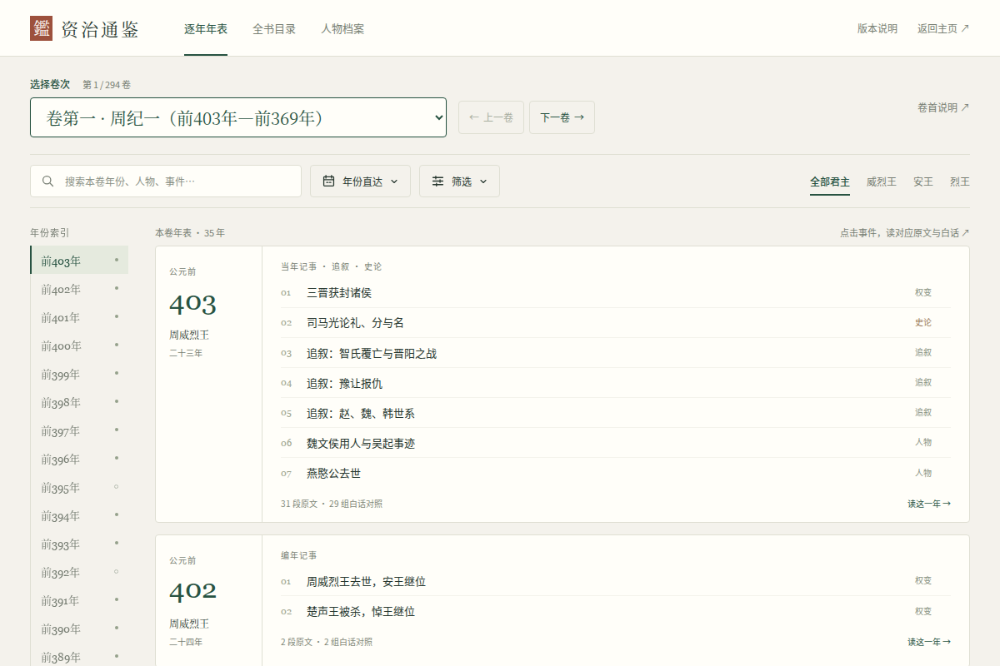

# 年表页头与筛选交互改造说明

日期：2026-10-17。状态：已按用户后续指令完成本地页面改造，未发布线上。

适用页面：`reader.html#volume-{卷号}` 的逐年年表，当前讨论入口为 `http://localhost:3003/tongjian/reader.html#volume-1`。

本文最初归档已确认的静态方案；后续用户明确要求据本文改造本地 `reader.html`，现已实施。改造以当前项目及 [设计约定](../.agents/skills/develop-tongjian/references/design-contract.md) 为基础，复用正式导航、搜索和阅读逻辑，没有直接用静态预览替换正式页面，未发布线上。

## 1. 改造目标

原页头把大标题、统计、朝代导航、选卷、跳年、年代横幅、搜索和多组筛选逐层展开，真正的年份与事件被推到首屏下方。

改造后让读者首先找到卷次，再浏览年份与事件。保留有用功能，通过合并、弱化与按需展开减少页头占用，继续使用朴素纸色、墨绿和细边框。

## 2. 用户明确确认的要求

| 项目 | 最终要求 |
| --- | --- |
| 页头信息密度 | 整体更简洁，年份与事件尽早进入首屏。 |
| 卷次入口 | “选择卷次”是最重要的导航，默认可见且醒目，不能藏在筛选里或做成弱化的辅助文字链接。 |
| 卷次选项 | 下拉选项标注卷名及起止年份，例如“卷第一 · 周纪一（前403年—前369年）”。 |
| 筛选展开方式 | 点击“筛选”，在同一行向右展开全部、人物、战争等选项；不使用侧边面板。 |
| 删除重复摘要 | 去掉卷次下方单独展示的“前403年 — 前369年”和“35 年 · 30 年有记事”整行。 |
| 实施边界 | 前期仅做预览与归档；后续已明确要求改造本地页面，不包含线上发布。 |

删除重复摘要时，保留下拉框中的年份，也保留实际年份数据。卷次旁的“第 1 / 294 卷”、年表结果中的年份数量，不属于这次要求删除的摘要行。

## 3. 最终页面组织

```text
原有全站导航

选择卷次 · 第 1 / 294 卷
[卷第一 · 周纪一（前403年—前369年）⌄]  [← 上一卷] [下一卷 →]
                                                     卷首说明

[搜索]  [年份直达⌄]  [筛选 → 全部 人物 战争 要事 权变 改革 …]  [君主]

年份索引                    本卷年表
前403年                     年份卡与事件列表
前402年                     ……
```

上图描述信息顺序；具体横向排列以桌面、手机效果图为准。手机中相邻卷按钮放到卷次选择上方的同一组区域，卷次下拉框占满可用宽度，让卷名和年份同时可读。

- 去掉原来的大幅宣传标题和整块深绿年代横幅。
- 卷次选择为页头主操作，使用明确标签、普通细边框、纸色底和下拉箭头；按用户后续要求，不使用墨绿高亮边框或文字，保留键盘焦点提示。
- 上一卷、下一卷始终在卷次选择附近；第一卷禁用上一卷，最后一卷禁用下一卷。
- 保留卷首说明入口，降低其视觉权重。
- 搜索、年份直达、筛选合并为紧凑操作栏。君主筛选在桌面保留标签，在手机使用下拉框。
- 桌面保留左侧年份索引；手机以年份卡为主。默认保留连续年份与未单列记事年份。
- 年份卡中的事件、追叙和史论保持原有顺序与含义，不靠删减事件压缩页头。

静态预览的尺寸、字体大小和间距作为视觉参考，以上信息层级与用户确认项优先。

## 4. 卷次下拉与导航

### 显示内容

包含全部294卷，按朝代分组。每个选项由卷号、卷名、年份范围构成，当前选中项也能看到年份。

示例：

- `卷第一 · 周纪一（前403年—前369年）`
- `卷第二百九十四 · 后周纪五（公元958年—公元959年）`

卷名、朝代、起止年从 `dist/catalog.json` 读取，不能把第一卷的展示值写死到正式页面。

项目年份键为正数表示公元前、负数表示公元后，没有0年。例如 `403` 显示为“前403年”，`-959` 显示为“公元959年”；不要按通常的公历正负号反向处理。跨公元纪年的范围应分别格式化两端。

### 正式导航行为

- 选卷继续调用现有卷次切换逻辑，加载对应年表并同步当前选项、卷号和浏览器历史。
- 相邻卷导航依据当前卷动态计算，不把“下一卷”固定到第二卷。
- 同一年分属相邻卷时，保留本年续篇与各卷定位。
- 朝代分组承担快速找卷的作用，不再默认铺开一整行朝代按钮。现有朝代跳转能力应合并到选卷入口。

静态预览只包含第一卷，选择其他卷时在新标签页打开现有本地网站，并把预览选择恢复到第一卷。**这是预览限制，不能照搬成正式站点的导航行为。**

## 5. 行内展开筛选（以最新要求为准）

点击“筛选”，在按钮右侧、同一行内横向展开选项，不再使用左侧面板、弹窗或遮罩。此要求替代早期静态预览中的左侧面板方案。

- 选项顺序为“全部、人物、战争、要事、权变、改革”，继续使用既有事件分类规则。
- “仅有记事年份”及“重置”也放在同一行，默认保留未单列记事年份。
- 选择类型或勾选条件即时更新年表，选项保持展开；再次点击“筛选”或按Esc收起，保留已选条件。
- 重置只清除事件类型与记事年份条件，不清空搜索或君主选择。
- 在操作栏中固定预留筛选区域，展开与收起仅改变该区域内的选项，不改变搜索、年份直达、筛选按钮及君主控件的位置、尺寸或显示形态。空间不足时只在筛选选项内部横向滚动。
- 手机使用固定的两行网格：第一行是搜索与年份直达，第二行是筛选区域与君主下拉框。选项与筛选按钮始终同一行，可左右滑动或用Tab访问后面的类型、复选框和重置按钮，展开不会造成整行重排。
- 触发器提供 `aria-controls`、`aria-expanded`。收起的选项隐藏且不可聚焦；展开后保持正常Tab顺序，Esc收起并将焦点返回“筛选”。
- 不锁定底层滚动、不限制键盘焦点、不改变浏览位置；点击搜索等其他控件不自动收起选项。
- 尊重减少动画偏好。非默认条件继续通过按钮数量标记和年表状态反馈。

阅读页仍为独立整页，保留现有阅读工具与对照布局。

## 6. 正式移植的代码范围与注意事项

| 文件或区域 | 实施内容 |
| --- | --- |
| `dist/reader.html` 的 `#annualPage` | 调整页头、卷次导航、操作栏；删除重复摘要；添加行内筛选及响应式样式。 |
| `dist/app.js` | 继续复用卷次加载、搜索、君主与事件筛选、年份跳转、历史及返回位置逻辑；适配新的DOM结构。 |
| `dist/catalog.json` | 只读取现有卷次元数据，生成带年份的选项，不为本次排版重建数据。 |
| `dist/search-worker.js` | 保留全书搜索流程；本次视觉改造不需要重写搜索。 |
| 其他入口及页面 | 不因预览的简化导航而删除主页、目录、人物、账户或主题等现有能力。 |

特别注意：

1. 原代码会直接写入 `#yearCount`、`#recordedCount`、`#volumeRange`、`#volumeDescription`、`#volumeHeading` 等节点。删除旧区域时同步整理这些写入，不能留下空引用错误，也不要靠隐藏整块旧页头维持逻辑。
2. `#volumeCount` 对应的卷次信息仍有用，应该接入新的卷号提示。`#volumeSelect` 继续与当前卷保持同步。
3. 原有 `#dynastyTabs`、`#dynastySelect` 的渲染与事件绑定，随朝代入口合并一起调整。
4. 尽量保留 `#search`、`#searchScope`、`#recordedOnly`、君主和事件筛选的现有状态及绑定；更名时统一更新。
5. 正式页面继续提供本卷与全书搜索。静态预览仅搜索第一卷，不能因此缩减正式搜索范围。
6. 行内筛选的样式和展开事件应独立命名，避免影响现有阅读工具和版本说明弹窗。
7. 正式卷首说明继续打开现有的完整卷首内容，不以预览中的简短说明替代。

本次不重建卷数据、不改原文、白话或对齐，不改变站点身份、正式网址与旧路径跳转规则。

## 7. 必须保留的阅读能力

- 逐年年表 → 年份或事件 → 独立整页阅读 → 返回原浏览位置。
- 桌面同组原文、白话左右对照；手机同组上下对照，采用共同滚动。
- 只读原文、只读白话及当前项目已有的其他阅读模式。
- 注释开关、字号、主题、前后年份、事件锚点及高亮、浏览器前进后退同步。
- 各卷完整原文、连续年份、缺译提示、追叙和史家评论的区分。

事件定位继续使用真实的段落锚点，例如第一卷前403年“追叙：智氏覆亡与晋阳之战”对应 `para-8`，不能用事件的列表序号代替。

## 8. 验收清单

| 场景 | 验收结果 |
| --- | --- |
| 桌面1200×800、1440×1000 | 第一眼能找到卷次；年份与事件进入首屏；页头没有独立的年代统计摘要行。 |
| 手机390×844及320px窄屏 | 卷名和年份可读，卷次与相邻卷入口可见；无遮挡、重叠或横向溢出。 |
| 卷次下拉 | 全部294卷有年份；公元前、公元后及跨纪年格式正确；朝代分组可用。 |
| 第一卷、最后一卷与中间卷 | 相邻卷禁用状态、加载内容、当前选项及路由一致。 |
| 筛选展开与收起 | 选项与按钮在同一行；再次点击或Esc收起；没有遮罩与滚动锁定；手机可在选项内横向滑动，页面无横向溢出。 |
| 筛选与搜索组合 | 事件、记事年份、君主、本卷/全书搜索可组合；重置不误清空其他条件，空结果有提示。 |
| 无记事年份 | 第一卷默认保留35年与5个未单列记事年份；勾选后显示30年，重置后恢复。 |
| 进入阅读再返回 | 事件锚点、搜索/筛选状态、年表滚动位置及浏览器历史保持正确。 |
| 阅读回归 | 对照、注释、字号、模式和主题等现有功能均可使用。 |

完成实施后执行项目已有检查：

```bash
node --check dist/app.js
node --check dist/search-worker.js
node scripts/check_reader.cjs
```

这些检查不能代替真实浏览器的桌面与手机验收。仅调整界面时不需要重建全书；若后续涉及数据修改，再按项目要求运行相应数据校验。

## 9. 早期静态参考与验证范围

独立预览文件：`/home/linqp/tongjian-preview/index.html`。本机预览地址：`http://localhost:3004/?v=4`；此地址不是线上部署地址，服务未运行时可直接用浏览器打开HTML文件。

以下为删除摘要行后的早期静态稿。卷次高亮与侧边筛选均已按后续要求调整，当前实施以第5节、第10节和实际页面为准：

| 效果图 | 视口 |
| --- | --- |
| [桌面年表](assets/reader-yearbook-redesign/desktop.png) | 1200×800 |
| [手机年表](assets/reader-yearbook-redesign/mobile.png) | 390×844 |
| [旧稿左侧筛选面板（已替代）](assets/reader-yearbook-redesign/filter-drawer-mobile.png) | 390×844 |



早期静态预览已检查294个卷次选项、公元前/后年份显示、320—1440px布局、左侧滑出动画、键盘焦点、滚动锁定、关闭方式、筛选与重置。最终截图中第一张年份卡位于桌面约295px、手机约334px处；这些数字是参考观察，不作为固定像素要求。

静态预览验证不等同于正式站点回归通过。正式移植仍须按上面的验收清单检查全部导航、搜索和阅读能力。


## 10. 本地实施记录

本地入口：`http://localhost:3003/tongjian/reader.html`。

- `dist/reader.html` 与 `dist/app.js` 已接入新的卷次导航、带年份的选项、相邻卷按钮、紧凑操作栏和行内筛选；重复摘要及旧朝代横排节点已移除。
- 新增 `dist/yearbook.css`、`dist/yearbook-controls.js`。阅读页样式仍使用原有文件；筛选面板独立命名，未改正文与译文数据。
- 长卷名在空间不足时，将当前卷名和年份分两行显示，仍使用原生下拉框，保留完整选项文字与键盘操作。
- 手机全站入口收进“菜单”，账户、主题、人物、摘记与版本说明等功能保留；菜单支持Esc关闭，阅读页继续使用原有工具入口。
- 1362个独立年份页复用同一阅读脚本，已同步更新其界面外壳。使用 `python scripts/year_reader.py --refresh-shell-only`，逐页检查原文/白话静态正文及SEO元数据与更新前完全一致，同时更新资源清单；没有重建卷数据。

回归命令：

```bash
node --check dist/app.js
node --check dist/search-worker.js
node --check dist/yearbook-controls.js
node scripts/check_reader.cjs
python scripts/check_yearbook_browser.py
python scripts/check_year_pages_browser.py
python scripts/check_seo.py
```

新增浏览器检查支持 `--base-url`，默认访问本机3003端口的 `/tongjian/`。检查涵盖320—1440px布局、294卷选项及跨公元纪年、行内筛选、横向滚动与键盘访问、全书搜索、筛选组合与重置、浏览器历史、真实事件锚点、阅读工具、原文白话桌面/手机对照、返回位置、年份直达和同年跨卷续读。

实际实施效果图保存在 [artifacts/yearbook-redesign/](../artifacts/yearbook-redesign/)，其中包括桌面、手机、筛选面板、长卷名及独立阅读效果。第9节的图片继续作为已确认静态方案参考。

本地验收结果：上述语法检查、全书导航检查、新增年表浏览器检查、独立年份页检查与SEO校验均通过。全书检查覆盖294卷、1419个年卷条目及全部段落锚点；SEO校验覆盖1732个生成页面，确认30584段原文的来源顺序保持一致。浏览器检查未发现JavaScript运行错误。

后续调整：卷次下拉框改用普通边框与正文颜色，取消墨绿高亮；长卷名的两行显示也使用正文颜色。入口位置与功能不变。


后续交互修订：筛选已由侧边面板改为与按钮同一行向右展开，保留全部类型、记事年份条件与重置；收起不丢失选择。桌面与手机当前效果见 [行内筛选桌面图](../artifacts/yearbook-redesign/inline-filters-1200.png) 和 [行内筛选手机图](../artifacts/yearbook-redesign/inline-filters-390.png)。旧左侧面板图仅保留为历史参考。

布局稳定性修订：操作栏为筛选预留固定空间，展开不再缩窄搜索框、替换君主控件或隐藏其他操作；浏览器检查同时比较展开前后各控件的坐标与尺寸。


## 11. 事件定位后的短暂高亮

点击年表事件进入原文、白话对照后，按真实段落锚点定位对应内容组。该组的四条边以橘色（`#e58a32`）闪动1次，持续0.8秒，结束后自动移除定位高亮，不改变段落尺寸或留下常驻边框。重复进入事件会重新播放；普通年份切换不触发闪动。

手机在同一内容组的原文与白话外围显示完整边框；减少动画偏好下改为等时长静态提示后消失。独立年份链接与阅读器使用相同实现。浏览器检查：`python scripts/check_reader_event_flash_browser.py`。

事件定位修正：滚动定位放到人物标注及阅读界面排版完成后的下一帧执行，按目标原文段落及其滚动边距定位；对靠近页面末尾的段落按需预留底部滚动空间，确保“燕愍公去世”等末段也能出现在固定阅读栏下方。提示消失后保留定位空间，切换年份或卷首时清除。
